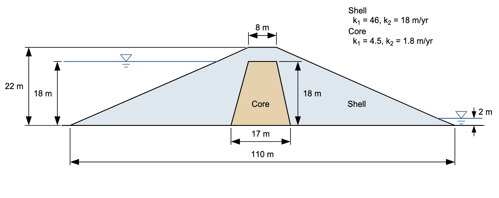
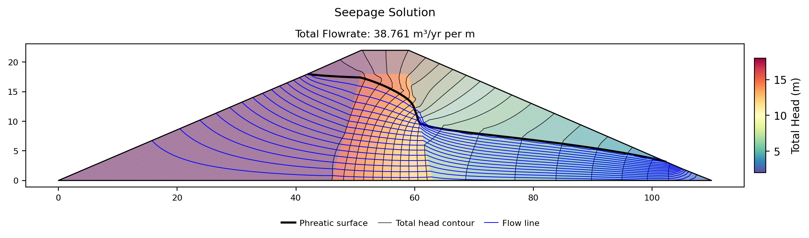

# GFDFlow — Theoretical Reference

Mathematical Foundations of the Generalized Finite Difference Method (GFDM), Crank-Nicolson Temporal Integration, and Steady & Transient Unsaturated Seepage Modeling in `GFDFlow`.

---

## Table of Contents

- **Part I — Generalized Finite Difference Method (GFDM) Foundations**
  - [1. Introduction to GFDM and the GFDFlow Framework](#1-introduction-to-gfdm-and-the-gfdflow-framework)
  - [2. The General Second-Order Linear Differential Operator](#2-the-general-second-order-linear-differential-operator)
  - [3. Taylor Series Expansion and Local Approximation](#3-taylor-series-expansion-and-local-approximation)
  - [4. Unweighted Least-Squares Approximation for Weight Calculation](#4-unweighted-least-squares-approximation-for-weight-calculation)
    - [4.1. Block Matrix System Construction](#41-block-matrix-system-construction)
    - [4.2. Solving the Weights](#42-solving-the-weights)
  - [5. Domain Discretization and Support Node Selection (Stars)](#5-domain-discretization-and-support-node-selection-stars)
  - [6. Implementation of Boundary Conditions](#6-implementation-of-boundary-conditions)
    - [6.1. Dirichlet Boundary Conditions](#61-dirichlet-boundary-conditions)
    - [6.2. Neumann Boundary Conditions and Ghost Node Formulation](#62-neumann-boundary-conditions-and-ghost-node-formulation)
  - [7. Interface Flux Balance for Layered Media](#7-interface-flux-balance-for-layered-media)
  - [8. Global System Assembly and Solution](#8-global-system-assembly-and-solution)
- **Part II — Parabolic Equations and the Crank-Nicolson Method**
  - [9. Temporal Discretization and the Crank-Nicolson Scheme](#9-temporal-discretization-and-the-crank-nicolson-scheme)
    - [9.1. Governing Parabolic PDE and Method-of-Lines Semi-Discretization](#91-governing-parabolic-pde-and-method-of-lines-semi-discretization)
    - [9.2. The Generalized Theta-Family and Crank-Nicolson Formulation](#92-the-generalized-theta-family-and-crank-nicolson-formulation)
    - [9.3. Consistency and Second-Order Local Truncation Error](#93-consistency-and-second-order-local-truncation-error)
    - [9.4. Spectral and Von Neumann Stability Analysis](#94-spectral-and-von-neumann-stability-analysis)
    - [9.5. Positivity, Stiffness Oscillations, and Rannacher Smoothing](#95-positivity-stiffness-oscillations-and-rannacher-smoothing)
    - [9.6. Sparse Computational Implementation in GFDFlow](#96-sparse-computational-implementation-in-gfdflow)
- **Part III — Unsaturated and Unconfined Seepage Flow**
  - [10. Physical Foundations and Governing Seepage Equations](#10-physical-foundations-and-governing-seepage-equations)
    - [10.1. Executive Overview and Numerical Challenges](#101-executive-overview-and-numerical-challenges)
    - [10.2. Physical State of Water in the Vadose Zone](#102-physical-state-of-water-in-the-vadose-zone)
    - [10.3. The General Darcy-Buckingham Flux Law and Anisotropy](#103-the-general-darcy-buckingham-flux-law-and-anisotropy)
    - [10.4. Steady Unconfined Seepage and Transient Richards Equations](#104-steady-unconfined-seepage-and-transient-richards-equations)
  - [11. Constitutive Relationships: Soil-Water Retention and Relative Conductivity](#11-constitutive-relationships-soil-water-retention-and-relative-conductivity)
    - [11.1. The van Genuchten (1980) and Mualem (1976) Model](#111-the-van-genuchten-1980-and-mualem-1976-model)
    - [11.2. The Gardner (1958) Power-Law Model](#112-the-gardner-1958-power-law-model)
    - [11.3. The Linear Front Model](#113-the-linear-front-model)
  - [12. Seepage Boundary Conditions and Interface Dynamics](#12-seepage-boundary-conditions-and-interface-dynamics)
    - [12.1. Specified Head Boundaries (Dirichlet)](#121-specified-head-boundaries-dirichlet)
    - [12.2. Exit Faces (Seepage Faces)](#122-exit-faces-seepage-faces)
    - [12.3. Specified Flux Boundaries (Neumann)](#123-specified-flux-boundaries-neumann)
  - [13. Nonlinear Formulations and Linearization Schemes](#13-nonlinear-formulations-and-linearization-schemes)
    - [13.1. The Picard Iteration](#131-the-picard-iteration)
    - [13.2. Mass-Balance Failure of Standard h-Based Picard Iteration](#132-mass-balance-failure-of-standard-h-based-picard-iteration)
    - [13.3. The Modified Picard Algorithm (Celia et al., 1990)](#133-the-modified-picard-algorithm-celia-et-al-1990)
    - [13.4. Finite Element Weak Form Reference (XSLOPE Formulation)](#134-finite-element-weak-form-reference-xslope-formulation)
  - [14. Advanced Solver Dynamics and Convergence Controls](#14-advanced-solver-dynamics-and-convergence-controls)
    - [14.1. Dynamic Under-Relaxation Ladder](#141-dynamic-under-relaxation-ladder)
    - [14.2. Three-Tier Hybrid Convergence Criteria](#142-three-tier-hybrid-convergence-criteria)
    - [14.3. Single-Element Wetting and Drying Hunting](#143-single-element-wetting-and-drying-hunting)
  - [15. Post-Processing: Phreatic Surface and Stream Function Flow Nets](#15-post-processing-phreatic-surface-and-stream-function-flow-nets)
    - [15.1. Pore Pressure Field and Phreatic Surface](#151-pore-pressure-field-and-phreatic-surface)
    - [15.2. Stream Function Formulation for 2D Flow Nets](#152-stream-function-formulation-for-2d-flow-nets)
- **Part IV — Transient Unsaturated and Unconfined Seepage (XSLOPE Reference Formulation and Benchmark)**
  - [16. Transient Seepage Formulation and Mass-Conservative Storage](#16-transient-seepage-formulation-and-mass-conservative-storage)
    - [16.1. Governing Mixed vs. Head-Based Continuity Equation](#161-governing-mixed-vs-head-based-continuity-equation)
    - [16.2. Sub-Element Storage Integration, Chord Splitting, and HRZ Lumped Storage](#162-sub-element-storage-integration-chord-splitting-and-hrz-lumped-storage)
    - [16.3. Storage Properties: Specific Storage, Specific Yield, and Zone-Separated Capacity](#163-storage-properties-specific-storage-specific-yield-and-zone-separated-capacity)
    - [16.4. Nonlinear Theta-Method Time Stepping and Hybrid Chord-Tangent Linearization](#164-nonlinear-theta-method-time-stepping-and-hybrid-chord-tangent-linearization)
    - [16.5. Adaptive Time-Stepping and Local Truncation Error Control](#165-adaptive-time-stepping-and-local-truncation-error-control)
    - [16.6. Time-Series Boundary Conditions, Dynamic Reservoir Hysteresis, and Exit-Face Cycling](#166-time-series-boundary-conditions-dynamic-reservoir-hysteresis-and-exit-face-cycling)
    - [16.7. Transient Post-Processing, Divergent Flow Fields, Mass-Balance Ledger, and Rapid-Drawdown Staging](#167-transient-post-processing-divergent-flow-fields-mass-balance-ledger-and-rapid-drawdown-staging)
  - [17. Benchmark Case Study: Zoned Earth Dam with Core (XSLOPE Sample 2 and Transient Drawdown)](#17-benchmark-case-study-zoned-earth-dam-with-core-xslope-sample-2-and-transient-drawdown)
    - [17.1. Geometry, Anisotropic Material Properties, and Boundary Configuration](#171-geometry-anisotropic-material-properties-and-boundary-configuration)
    - [17.2. Steady-State Unconfined Seepage Solution and Constitutive Sensitivity](#172-steady-state-unconfined-seepage-solution-and-constitutive-sensitivity)
    - [17.3. Transient Reservoir Drawdown Extension and Differential Zone Drainage](#173-transient-reservoir-drawdown-extension-and-differential-zone-drainage)
- **Part V — Methodological Synthesis and References**
  - [18. Comparative Methodological Matrices](#18-comparative-methodological-matrices)
  - [19. Synthesis and Implementation Recommendations for GFDFlow](#19-synthesis-and-implementation-recommendations-for-gfdflow)
  - [20. References](#20-references)

---

# Part I — Generalized Finite Difference Method (GFDM) Foundations

## 1. Introduction to GFDM and the GFDFlow Framework

The Generalized Finite Difference Method (GFDM) is a robust numerical technique implemented in the `GFDFlow` Python package to solve complex two-dimensional transport phenomena. As an object-oriented framework, `GFDFlow` discretizes second-order differential operators, converting partial differential equations (PDEs) into solvable systems of sparse linear or nonlinear algebraic equations.

GFDM offers significant computational advantages over traditional Finite Element Methods (FEM) and Finite Difference Methods (FDM):

* **Flexibility in Node Distribution:** Unlike standard FDM, which is constrained to rectangular grids, GFDM operates on arbitrary node distributions, including non-rectangular structured and unstructured grids.
* **Meshless "Point-Set" Nature:** GFDM eliminates the need for formal element numerical quadrature, managing irregular geometries by utilizing local "stars" of support nodes.
* **Computational Efficiency:** The method provides second-order spatial accuracy with lower assembly overhead than FEM, particularly in geosciences and geotechnical engineering applications involving irregular, multi-layered domains.

---

## 2. The General Second-Order Linear Differential Operator

`GFDFlow` is designed to solve the general second-order linear differential operator $L$. In the stationary case, the governing problem is formulated as $Lu = f$, where $u$ represents the unknown field variable (e.g., total hydraulic head $h$ or solute concentration $C$) and $f$ is the volumetric source term. In a two-dimensional domain $\Omega \subset \mathbb{R}^2$, the operator $L$ is expanded as:

$$Lu = A u + B \frac{\partial u}{\partial x} + C \frac{\partial u}{\partial y} + D \frac{\partial^2 u}{\partial x^2} + E \frac{\partial^2 u}{\partial x \partial y} + F \frac{\partial^2 u}{\partial y^2} = f$$

Alternatively expressed in subscript notation as:

$$Lu = A u + B u_x + C u_y + D u_{xx} + E u_{xy} + F u_{yy} = f$$

where the coefficients and terms are defined as:

* $A, B, C, D, E, F$: Spatial functions $g(x, y)$ representing physical properties such as permeability, dispersion, advection velocity, or reaction rates.
* $u_x, u_y$: First-order partial derivatives ($\frac{\partial u}{\partial x}, \frac{\partial u}{\partial y}$).
* $u_{xx}, u_{xy}, u_{yy}$: Second-order partial derivatives ($\frac{\partial^2 u}{\partial x^2}, \frac{\partial^2 u}{\partial x \partial y}, \frac{\partial^2 u}{\partial y^2}$).
* $f$: The source value, provided as a function of spatial coordinates $\boldsymbol{p} = [x, y]$.

---

## 3. Taylor Series Expansion and Local Approximation

The core logic of GFDM involves approximating the operator $L$ at a central node $\boldsymbol{p}_0$ through the function values at a local set of support nodes, known as a "star".

1. **Selection of Support Nodes:** For a central node $\boldsymbol{p}_0$, a set of $q$ support nodes $\boldsymbol{p}_i$ ($i = 1, \dots, q$) is selected.
2. **Local Approximation:** The local discrete operator $L_0$ is defined as a linear combination of nodal function values $u_i = u(\boldsymbol{p}_i)$:

$$L_0 u = \sum_{i=0}^q \Gamma_i u(\boldsymbol{p}_i)$$

3. **Consistency Requirement:** The weights $\Gamma_i$ must be chosen such that the local truncation error $\tau = Lu - L_0 u$ approaches zero as $\max_{i} \|\boldsymbol{p}_i - \boldsymbol{p}_0\| \to 0$.
4. **Taylor Expansion:** Expanding each neighbor value $u(\boldsymbol{p}_i)$ around $\boldsymbol{p}_0 = (x_0, y_0)$ via a second-order bivariate Taylor polynomial:

$$u(\boldsymbol{p}_i) = u_0 + \Delta x_i u_x + \Delta y_i u_y + \frac{(\Delta x_i)^2}{2} u_{xx} + \Delta x_i \Delta y_i u_{xy} + \frac{(\Delta y_i)^2}{2} u_{yy} + \mathcal{O}(\bar{h}^3)$$

and substituting into the consistency condition yields a local linear system for the stencil weights $\Gamma_i$.

---

## 4. Unweighted Least-Squares Approximation for Weight Calculation

To calculate the weights $\Gamma_i$, `GFDFlow` solves an unweighted least-squares problem (Tinoco-Guerrero et al., 2018; Chávez-Negrete et al., 2023). This avoids the empirical radial weight calibration required by weighted moving least squares while maintaining stability on well-graded Delaunay point clouds.

### 4.1. Block Matrix System Construction

The weights for the support nodes $(\Gamma_1, \dots, \Gamma_q)^T$ satisfy the underdetermined/overdetermined consistency system:

$$M \boldsymbol{\Gamma} = \boldsymbol{\beta}$$

where $M$ is a $5 \times q$ matrix of spatial coordinate increments (or $6 \times (q+1)$ when including the zeroth-order central node row $[1, 1, \dots, 1]$):

$$M = \begin{pmatrix} 
\Delta x_1 & \dots & \Delta x_q \\ 
\Delta y_1 & \dots & \Delta y_q \\ 
(\Delta x_1)^2 & \dots & (\Delta x_q)^2 \\ 
\Delta x_1 \Delta y_1 & \dots & (\Delta x_q \Delta y_q) \\ 
(\Delta y_1)^2 & \dots & (\Delta y_q)^2 
\end{pmatrix}$$

The right-hand-side vector $\boldsymbol{\beta}$ contains the operator coefficients evaluated at $\boldsymbol{p}_0$, scaled to match the factorial denominators of the second-order Taylor terms, $\boldsymbol{\beta} = [B, C, 2D, E, 2F]^T$:

| Matrix $M$ Term | Derivative Component | Vector $\boldsymbol{\beta}$ Coefficient |
|---|---|---|
| $\Delta x_i$ | $u_x$ | $B$ |
| $\Delta y_i$ | $u_y$ | $C$ |
| $(\Delta x_i)^2$ | $u_{xx}$ | $2D$ |
| $\Delta x_i \Delta y_i$ | $u_{xy}$ | $E$ |
| $(\Delta y_i)^2$ | $u_{yy}$ | $2F$ |

*(Note: $\Delta x_i = x_i - x_0$ and $\Delta y_i = y_i - y_0$.)*

### 4.2. Solving the Weights

When $q > 5$ and $M$ has full row rank ($\operatorname{rank}(M) = 5$), the system is underdetermined for $\boldsymbol{\Gamma} \in \mathbb{R}^q$ (equivalently, its transpose normal system is overdetermined), admitting an affine manifold of consistent stencils. `GFDFlow` selects the minimum Euclidean norm solution via the Moore-Penrose pseudo-inverse $M^+ = M^T (M M^T)^{-1}$:

$$\boldsymbol{\Gamma} = M^+ \boldsymbol{\beta}$$

Finally, the weight for the central node $\Gamma_0$ is determined by enforcing zeroth-order consistency:

$$\Gamma_0 = A - \sum_{i=1}^q \Gamma_i$$

where $A$ is the reaction/zeroth-order coefficient of $u$ in the governing operator $L$.

---

## 5. Domain Discretization and Support Node Selection (Stars)

`GFDFlow` discretizes the domain $\Omega$ into a point cloud. The `get_support_nodes_2D` utility identifies the support "star" for each node using topological adjacency:

* **Initial Selection:** Nodes are initially selected if they share an edge/triangle (via Delaunay or Gmsh triangulation) with the central node $\boldsymbol{p}_0$.
* **Minimum Node Requirement:** A minimum `min_support_nodes` of 5 neighbors is required to ensure the Taylor moment matrix $M$ can achieve full row rank.
* **Iteration Logic:** If fewer than the required neighbors are found, the search expands iteratively (`max_iter = 2`) to include topological second-ring ("neighbors of neighbors") nodes.
* **Symmetry:** Delaunay-based triangulation produces quasi-isotropic 6-neighbor stars around interior nodes, preserving discrete self-adjointness and diagonal dominance for elliptic and parabolic diffusion operators.

---

## 6. Implementation of Boundary Conditions

### 6.1. Dirichlet Boundary Conditions

Dirichlet conditions prescribe known values $u(\boldsymbol{p}) = u_D(\boldsymbol{p}, t)$ on $\Gamma_D$. In the global sparse matrix, rows corresponding to Dirichlet nodes are replaced by identity constraints ($K_{ii} = 1$, $K_{ij} = 0$ for $j \neq i$, $F_i = u_D(\boldsymbol{p}_i, t)$).

### 6.2. Neumann Boundary Conditions and Ghost Node Formulation

Neumann conditions specify the outward normal derivative $\frac{\partial u}{\partial n} = \nabla u \cdot \boldsymbol{n} = g_N(\boldsymbol{p}, t)$ on $\Gamma_N$. `GFDFlow` employs a ghost-node elimination strategy (Chávez-Negrete et al., 2021, 2023) to retain second-order boundary accuracy without degrading star conditioning:

* **Ghost Node ($\boldsymbol{p}_g$):** A virtual node is placed outside the domain along the outward unit normal $\boldsymbol{n} = [n_x, n_y]^T$ at distance $\bar{h}$ (the mean star radius), $\boldsymbol{p}_g = \boldsymbol{p}_0 + \bar{h}\boldsymbol{n}$.
* **Augmented Star Discretization:** Both the governing PDE operator $L_0 u$ and the normal derivative operator $\frac{\partial u}{\partial n} = n_x u_x + n_y u_y$ are discretized over the augmented star $\{\boldsymbol{p}_g, \boldsymbol{p}_0, \boldsymbol{p}_1, \dots, \boldsymbol{p}_q\}$:

$$L_0 u = \Gamma_g u(\boldsymbol{p}_g) + \sum_{l=0}^q \Gamma_l u(\boldsymbol{p}_l) = f(\boldsymbol{p}_0), \qquad \left.\frac{\partial u}{\partial n}\right|_{\boldsymbol{p}_0} \approx \hat{\Gamma}_g u(\boldsymbol{p}_g) + \sum_{l=0}^q \hat{\Gamma}_l u(\boldsymbol{p}_l) = g_N(\boldsymbol{p}_0)$$

* **Algebraic Elimination:** Solving the normal-derivative stencil for the virtual value $u(\boldsymbol{p}_g)$:

$$u(\boldsymbol{p}_g) = \frac{1}{\hat{\Gamma}_g} g_N(\boldsymbol{p}_0) - \sum_{l=0}^q \frac{\hat{\Gamma}_l}{\hat{\Gamma}_g} u(\boldsymbol{p}_l)$$

  and substituting into $L_0 u = f(\boldsymbol{p}_0)$ eliminates $u(\boldsymbol{p}_g)$ algebraically:

$$\sum_{l=0}^q \left( \Gamma_l - G_g \hat{\Gamma}_l \right) u(\boldsymbol{p}_l) = f(\boldsymbol{p}_0) - G_g g_N(\boldsymbol{p}_0), \qquad G_g = \frac{\Gamma_g}{\hat{\Gamma}_g}$$

---

## 7. Interface Flux Balance for Layered Media

In stratified or zoned porous media with discontinuous hydraulic properties (e.g., rockfill shells with $k_r = 10^{-4}\text{ m/s}$ abutting a clay core with $k_c = 10^{-6}\text{ m/s}$), standard跨-interface finite-difference stars produce severe non-physical oscillations. `GFDFlow` resolves material discontinuities via a **subdomain-restricted star and normal Darcy flux balance** (Chávez-Negrete et al., 2023):

* **Interface Mass Conservation:** Across an interface node $\boldsymbol{p}_0$ shared by $n_l$ material layers/wedges ($n_l = 2$ on smooth interfaces; $n_l = 3$ at triple junctions), continuity of hydraulic head $u^{(1)}(\boldsymbol{p}_0) = \dots = u^{(n_l)}(\boldsymbol{p}_0)$ is paired with conservation of normal flux:

$$\sum_{s=1}^{n_l} \left( k_{x,s} \frac{\partial u}{\partial x} l_{x,s} + k_{y,s} \frac{\partial u}{\partial y} l_{y,s} \right) = \beta(\boldsymbol{p}_0)$$

  where $(l_{x,s}, l_{y,s})$ are the direction cosines of the outward unit normal $\boldsymbol{n}_s$ pointing out of layer $s$ ($\boldsymbol{n}_2 = -\boldsymbol{n}_1$ on a two-material interface) and $\beta$ is an optional interfacial source/sink ($\beta = 0$ for pure continuity).
* **One-Sided Sub-Stencils via Ghost Elimination:** On each layer $s$, nodes belonging to foreign layers are excluded from the support star ($I_s = I \setminus \Omega_{\text{other}}$), a layer-specific ghost node $\boldsymbol{p}_{g,s} = \boldsymbol{p}_0 + \bar{h}_s \boldsymbol{n}_s$ is introduced, and the eliminated stencil contributions from all $n_l$ layers are summed directly into row $i$ of the global matrix $\mathbf{K}$.
* **Interface API Parameters in `GFDFlow`:**
  * `k_left` / `k_right`: Permeability functions on sides $s = 0$ and $s = 1$.
  * `beta`: Interfacial flux jump $\beta(\boldsymbol{p})$ ($0$ for flux continuity).
  * `alpha`: Potential jump $\alpha(\boldsymbol{p})$ for discontinuous contact resistance (omitted in `continuous_discretization()`).

---

## 8. Global System Assembly and Solution

The transition from local star approximations to the global algebraic system $\mathbf{K}\boldsymbol{u} = \boldsymbol{F}$ constitutes the stationary assembly workflow:

* **Sparse Assembly:** Local weights for interior, Neumann, interface, triple-junction, and Dirichlet rows are assembled into Compressed Sparse Row (`scipy.sparse.csr_matrix`) format.
* **Direct Sparse Solve:** Stationary problems solve $\mathbf{K}\boldsymbol{u} = \boldsymbol{F}$ via sparse LU factorization (`scipy.sparse.linalg.spsolve`).
* **Standard Stationary Workflow:**
  1. **Mesh & Topology Loading:** Define or load nodal coordinates `coords`, connectivity `triangles`, outward `normal_vectors`, `support_stencils`, and pseudo-inverses `M_pinv`.
  2. **Problem Initialization:** Instantiate `GFDMI_2D_problem`.
  3. **Subdomain & Boundary Registration:** Register `material`, `dirichlet_boundary`, `neumann_boundary`, `interface`, and `intersection` specifications.
  4. **Discretization & Solve:** Call `K, F = problem.continuous_discretization()` and solve `u = spsolve(K, F)`.

---

# Part II — Parabolic Equations and the Crank-Nicolson Method

## 9. Temporal Discretization and the Crank-Nicolson Scheme

Many subsurface hydrological and transport processes—such as transient piezometric response during reservoir impoundment, rapid drawdown in zoned embankment dams, aquifer pumping tests, and heat or contaminant diffusion—are governed by **parabolic partial differential equations**. Originally introduced by **John Crank and Phyllis Nicolson (1947)** to model transient heat conduction coupled with nonlinear reaction kinetics, the **Crank-Nicolson (CN) method** combines spatial discretization with implicit midpoint/trapezoidal time integration to achieve **second-order temporal accuracy** and **unconditional $A$-stability**.

---

### 9.1. Governing Parabolic PDE and Method-of-Lines Semi-Discretization

Consider transient potential groundwater flow in a two-dimensional heterogeneous domain $\Omega = \bigcup_{s=1}^{n_m} \Omega_s \subset \mathbb{R}^2$ over time interval $t \in (0, T]$:

$$S_s(\boldsymbol{x}) \frac{\partial u}{\partial t} = \nabla \cdot \left( k(\boldsymbol{x}) \nabla u \right) - f(\boldsymbol{x}, t), \qquad \boldsymbol{x} \in \Omega, \; t > 0$$

subject to initial and boundary conditions:

$$\begin{aligned}
u(\boldsymbol{x}, 0) &= u_0(\boldsymbol{x}), && \boldsymbol{x} \in \Omega \\
u(\boldsymbol{x}, t) &= u_D(\boldsymbol{x}, t), && \boldsymbol{x} \in \Gamma_D, \; t > 0 \\
k(\boldsymbol{x}) \frac{\partial u}{\partial n} &= g_N(\boldsymbol{x}, t), && \boldsymbol{x} \in \Gamma_N, \; t > 0 \\
\sum_{s \in \mathcal{I}(\boldsymbol{x})} k_s \frac{\partial u^{(s)}}{\partial n_s} &= \beta(\boldsymbol{x}, t), && \boldsymbol{x} \in \Gamma_{\mathrm{int}}, \; t > 0
\end{aligned}$$

where:
* $u(\boldsymbol{x}, t)$: Total hydraulic head ($L$).
* $S_s(\boldsymbol{x}) > 0$: Specific storage coefficient ($L^{-1}$), representing the volume of water released from or taken into elastic storage per unit bulk volume per unit change in head ($S_s = 1$ in normalized/dimensionless diffusion formulations).
* $k(\boldsymbol{x}) > 0$: Saturated hydraulic conductivity ($L/T$).
* $D_h(\boldsymbol{x}) = k(\boldsymbol{x}) / S_s(\boldsymbol{x})$: Hydraulic diffusivity ($L^2/T$), governing the propagation speed of pressure transients.

*(Sign convention note: In `GFDFlow`, the stationary operator `K, F = problem.continuous_discretization()` discretizes $+k \nabla^2 u = f$ such that $(\mathbf{K}\boldsymbol{u})_i \approx +k(\boldsymbol{x}_i)\nabla^2 u(\boldsymbol{x}_i)$ on interior and ghost-eliminated Neumann nodes. Consequently, at steady state $\frac{\partial u}{\partial t} = 0$, the discrete balance reduces identically to $\mathbf{K}\boldsymbol{u} - \boldsymbol{F} = \mathbf{0} \iff \mathbf{K}\boldsymbol{u} = \boldsymbol{F}$.)*

Applying the **Method of Lines (MOL)**—discretizing spatial derivatives via GFDM stars while keeping time continuous—partitions the nodal unknowns $\boldsymbol{u}(t) \in \mathbb{R}^N$ into **free nodes** $\mathcal{F} = \{0, \dots, N-1\} \setminus \mathcal{D}$ (interior, Neumann, interface, and triple-junction nodes) and **Dirichlet boundary nodes** $\mathcal{D}$:

$$\begin{aligned}
\mathbf{M}_{\mathcal{F}\mathcal{F}} \frac{d\boldsymbol{u}_{\mathcal{F}}}{dt} &= \mathbf{K}_{\mathcal{F}\mathcal{F}} \boldsymbol{u}_{\mathcal{F}}(t) + \mathbf{K}_{\mathcal{F}\mathcal{D}} \boldsymbol{u}_{\mathcal{D}}(t) - \boldsymbol{F}_{\mathcal{F}}(t), && t > 0 \\
\boldsymbol{u}_{\mathcal{D}}(t) &= \boldsymbol{u}_D(t), && t > 0
\end{aligned}$$

where $\mathbf{M}_{\mathcal{F}\mathcal{F}} = \operatorname{diag}(M_{ii})$ is the diagonal storage capacity matrix ($M_{ii} = S_s$ for uniform storage, and $M_{ii} = S_s \equiv 1$ in the normalized formulation $S_s \frac{d\boldsymbol{u}}{dt} = \mathbf{K}\boldsymbol{u} - \boldsymbol{F}$). Because $\mathbf{K}_{\mathcal{F}\mathcal{F}}$ discretizes a negative-definite elliptic diffusion operator with Dirichlet boundary anchoring ($\mathcal{D} \neq \emptyset$), all eigenvalues $\lambda_m$ of the generalized eigenproblem $\mathbf{K}_{\mathcal{F}\mathcal{F}} \boldsymbol{v}_m = \lambda_m \mathbf{M}_{\mathcal{F}\mathcal{F}} \boldsymbol{v}_m$ satisfy $\operatorname{Re}(\lambda_m) < 0$.

---

### 9.2. The Generalized Theta-Family and Crank-Nicolson Formulation

Partitioning the time axis into discrete levels $0 = t^0 < t^1 < \dots < t^n < t^{n+1} = t^n + \Delta t$ and integrating the semi-discrete ODE exactly over $[t^n, t^{n+1}]$ gives:

$$\mathbf{M}_{\mathcal{F}\mathcal{F}} \left(\boldsymbol{u}_{\mathcal{F}}^{n+1} - \boldsymbol{u}_{\mathcal{F}}^n\right) = \int_{t^n}^{t^{n+1}} \left( \mathbf{K}_{\mathcal{F}\mathcal{F}} \boldsymbol{u}_{\mathcal{F}}(\tau) + \mathbf{K}_{\mathcal{F}\mathcal{D}} \boldsymbol{u}_{\mathcal{D}}(\tau) - \boldsymbol{F}_{\mathcal{F}}(\tau) \right) d\tau$$

Approximating the time integral via a convex $\theta$-weighted quadrature rule with $\theta \in [0, 1]$ yields the **generalized $\theta$-method**:

$$\mathbf{M}_{\mathcal{F}\mathcal{F}} \frac{\boldsymbol{u}_{\mathcal{F}}^{n+1} - \boldsymbol{u}_{\mathcal{F}}^n}{\Delta t} = \theta \boldsymbol{R}_{\mathcal{F}}^{n+1} + (1 - \theta) \boldsymbol{R}_{\mathcal{F}}^n, \qquad \boldsymbol{R}_{\mathcal{F}}^k \equiv \mathbf{K}_{\mathcal{F}\mathcal{F}} \boldsymbol{u}_{\mathcal{F}}^k + \mathbf{K}_{\mathcal{F}\mathcal{D}} \boldsymbol{u}_{\mathcal{D}}^k - \boldsymbol{F}_{\mathcal{F}}^k$$

| Parameter $\theta$ | Scheme Name | Temporal Order | Stability Class | Behavior on Stiff Modes ($z \to -\infty$) |
|---|---|---|---|---|
| $\theta = 0$ | Explicit Forward Euler (FTCS) | $\mathcal{O}(\Delta t)$ | Conditionally stable ($\Delta t \le \frac{2}{|\lambda_{\min}|}$) | Unstable ($R(z) \to -\infty$) |
| $\theta = \frac{1}{2}$ | **Crank-Nicolson (Trapezoidal)** | **$\mathcal{O}(\Delta t^2)$** | **Unconditionally $A$-stable** | Non-damping sign flip ($R(z) \to -1$) |
| $\theta = \frac{2}{3}$ | Galerkin Time-Stepping | $\mathcal{O}(\Delta t)$ | Unconditionally $A$-stable | Strongly damped ($R(z) \to -\frac{1}{2}$) |
| $\theta = 1$ | Implicit Backward Euler (BTCS) | $\mathcal{O}(\Delta t)$ | **Unconditionally $L$-stable** | Asymptotically exact damping ($R(z) \to 0$) |

Setting $\theta = \frac{1}{2}$ defines the **Crank-Nicolson scheme**, which coincides with the implicit trapezoidal rule centered at the temporal midpoint $t^{n+1/2} = t^n + \frac{\Delta t}{2}$:

$$S_s \frac{\boldsymbol{u}_{\mathcal{F}}^{n+1} - \boldsymbol{u}_{\mathcal{F}}^n}{\Delta t} = \frac{1}{2} \left( \mathbf{K}_{\mathcal{F}\cdot} \boldsymbol{u}^{n+1} - \boldsymbol{F}_{\mathcal{F}}^{n+1} \right) + \frac{1}{2} \left( \mathbf{K}_{\mathcal{F}\cdot} \boldsymbol{u}^n - \boldsymbol{F}_{\mathcal{F}}^n \right)$$

Collecting unknown time-level $n+1$ terms on the left-hand side and known time-level $n$ terms on the right-hand side produces the global $N \times N$ sparse linear system solved at each step:

$$\mathbf{A}_{\mathrm{LHS}} \boldsymbol{u}^{n+1} = \boldsymbol{b}^n$$

where:
1. **On free rows ($i \in \mathcal{F}$):**

$$\left( \mathbf{M} - \frac{\Delta t}{2} \mathbf{K} \right)_{i, :} \boldsymbol{u}^{n+1} = \left( \mathbf{M} + \frac{\Delta t}{2} \mathbf{K} \right)_{i, :} \boldsymbol{u}^n - \frac{\Delta t}{2} \left( F_i^n + F_i^{n+1} \right)$$

2. **On Dirichlet boundary rows ($i \in \mathcal{D}$):**

$$A_{\mathrm{LHS}, ii} = 1, \qquad A_{\mathrm{LHS}, ij} = 0 \; (j \neq i), \qquad b_i^n = u_D(\boldsymbol{x}_i, t^{n+1})$$

*(Crucial boundary implementation detail: Dirichlet rows must be enforced algebraically at $t^{n+1}$ rather than integrated via $\frac{du_i}{dt} = K_{ii} u_i - F_i$, because $K_{ii} = +1 > 0$ in `GFDFlow`'s stationary identity convention would otherwise introduce an unstable $+1$ eigenvalue on $\mathcal{D}$.)*

```
  Time Level n+1   ●─────────●─────────●   Implicit stencil: 1/2 (K u^{n+1} - F^{n+1})
  (t^n + Δt)                 ▲
                             │             Centered at midpoint t^{n+1/2}:
  Midpoint n+1/2   - - - - - ┼ - - - - -     du/dt|_{n+1/2}  = (u^{n+1} - u^n)/Δt + O(Δt²)
                             │               Lu|_{n+1/2}     = (Lu^{n+1} + Lu^n)/2 + O(Δt²)
  Time Level n     ●─────────●─────────●   Explicit stencil: 1/2 (K u^n - F^n)
  (t^n)           p_j       p_0       p_k  (GFDM star of q support neighbors)
```

---

### 9.3. Consistency and Second-Order Local Truncation Error

Let $u(\boldsymbol{x}, t) \in C^4(\bar{\Omega} \times [0, T])$ denote the exact smooth solution of $S_s u_t - Lu = -f$ (with spatial operator $Lu = \nabla \cdot (k \nabla u)$). Evaluating the local truncation error $\tau_0^{n+1/2}$ of the Crank-Nicolson–GFDM discretization around the space-time midpoint $(\boldsymbol{x}_0, t^{n+1/2})$:

$$\tau_0^{n+1/2} = S_s \frac{u(\boldsymbol{x}_0, t^{n+1}) - u(\boldsymbol{x}_0, t^n)}{\Delta t} - \frac{1}{2}\left[ (L_0 u)(\boldsymbol{x}_0, t^{n+1}) + (L_0 u)(\boldsymbol{x}_0, t^n) \right] + \frac{f^{n+1} + f^n}{2}$$

Expanding $u^{n+1} = u(t^{n+1/2} + \frac{\Delta t}{2})$ and $u^n = u(t^{n+1/2} - \frac{\Delta t}{2})$ in Taylor series around $t^{n+1/2}$:

$$u^{n+1} = u^{n+1/2} + \frac{\Delta t}{2} u_t^{n+1/2} + \frac{\Delta t^2}{8} u_{tt}^{n+1/2} + \frac{\Delta t^3}{48} u_{ttt}^{n+1/2} + \mathcal{O}(\Delta t^4)$$

$$u^n = u^{n+1/2} - \frac{\Delta t}{2} u_t^{n+1/2} + \frac{\Delta t^2}{8} u_{tt}^{n+1/2} - \frac{\Delta t^3}{48} u_{ttt}^{n+1/2} + \mathcal{O}(\Delta t^4)$$

1. **Centered Difference Quotient:** Subtracting the two expansions cancels all even powers of $\Delta t$:

$$\frac{u^{n+1} - u^n}{\Delta t} = u_t^{n+1/2} + \frac{\Delta t^2}{24} u_{ttt}^{n+1/2} + \mathcal{O}(\Delta t^4)$$

2. **Trapezoidal Spatial Average:** Averaging the GFDM discrete spatial operator $L_0 u = Lu + \tau_{\mathrm{space}}$ (where $\tau_{\mathrm{space}} = \mathcal{O}(\bar{h}^2)$ for second-order Taylor stars of characteristic radius $\bar{h}$) cancels all odd powers of $\Delta t$:

$$\frac{L_0 u^{n+1} + L_0 u^n}{2} = Lu^{n+1/2} + \frac{\Delta t^2}{8} L u_{tt}^{n+1/2} + \mathcal{O}(\bar{h}^2) + \mathcal{O}(\Delta t^4)$$

3. **Combined Space-Time Local Truncation Error:** Using $S_s u_t^{n+1/2} - Lu^{n+1/2} + f^{n+1/2} = 0$, the zeroth- and first-order temporal errors vanish identically:

$$\tau_0^{n+1/2} = \left( \frac{S_s}{24} u_{ttt}^{n+1/2} - \frac{1}{8} L u_{tt}^{n+1/2} + \frac{1}{8} f_{tt}^{n+1/2} \right) \Delta t^2 + \mathcal{O}(\bar{h}^2) + \mathcal{O}(\Delta t^4) = \mathcal{O}\!\left(\Delta t^2 + \bar{h}^2\right)$$

Because $\lim_{\Delta t, \bar{h} \to 0} \tau_0^{n+1/2} = 0$, the Crank-Nicolson–GFDM scheme is unconditionally **consistent** of second order in both space and time. By the **Lax-Richtmyer Equivalence Theorem**, for a well-posed linear initial-boundary value problem, consistency together with stability guarantees second-order global convergence:

$$\|\boldsymbol{u}^n - \boldsymbol{u}(t^n)\| \le C_T \left( \Delta t^2 + \bar{h}^2 \right), \qquad 0 \le n \Delta t \le T$$

---

### 9.4. Spectral and Von Neumann Stability Analysis

#### A. Matrix Spectral ($A$-Stability) Analysis on Irregular GFDM Point Clouds
On unstructured GFDM clouds, the discrete operator $\mathbf{A}_{\mathcal{F}} = \mathbf{M}_{\mathcal{F}\mathcal{F}}^{-1} \mathbf{K}_{\mathcal{F}\mathcal{F}}$ is generally non-symmetric due to irregular local star geometry and ghost-node eliminations, so its eigenvalues $\lambda_m = -\mu_m + i \omega_m$ may carry small imaginary parts alongside strictly negative real parts ($\operatorname{Re}(\lambda_m) = -\mu_m < 0$).

For homogeneous boundary data ($\boldsymbol{u}_{\mathcal{D}} = \mathbf{0}$, $\boldsymbol{F}_{\mathcal{F}} = \mathbf{0}$), one Crank-Nicolson step maps error vector $\boldsymbol{e}^n = \boldsymbol{u}^n - \boldsymbol{u}_{\mathrm{exact}}^n$ via:

$$\boldsymbol{e}_{\mathcal{F}}^{n+1} = \left( \mathbf{I} - \frac{\Delta t}{2} \mathbf{A}_{\mathcal{F}} \right)^{-1} \left( \mathbf{I} + \frac{\Delta t}{2} \mathbf{A}_{\mathcal{F}} \right) \boldsymbol{e}_{\mathcal{F}}^n$$

Projecting onto an eigenmode $\boldsymbol{v}_m$ with complex dimensionless step parameter $z_m = \lambda_m \Delta t \in \mathbb{C}$ yields the **Padé $(1,1)$ rational stability function**:

$$R_{\mathrm{CN}}(z) = \frac{1 + z/2}{1 - z/2}$$

Computing the squared modulus for $z = x + i y$ ($x = \operatorname{Re}(\lambda_m)\Delta t$, $y = \operatorname{Im}(\lambda_m)\Delta t$):

$$\left| R_{\mathrm{CN}}(x + i y) \right|^2 = \frac{(1 + x/2)^2 + (y/2)^2}{(1 - x/2)^2 + (y/2)^2} = \frac{1 + x + \frac{1}{4}(x^2 + y^2)}{1 - x + \frac{1}{4}(x^2 + y^2)}$$

Therefore:

$$\left| R_{\mathrm{CN}}(z) \right| \le 1 \iff 1 + x \le 1 - x \iff x = \operatorname{Re}(z) \le 0$$

The stability domain $\mathcal{S}_{\mathrm{CN}} = \{ z \in \mathbb{C} : |R_{\mathrm{CN}}(z)| \le 1 \}$ coincides **exactly** with the closed left half of the complex plane $\mathbb{C}^-$. Thus:
1. **Unconditional $A$-Stability:** Crank-Nicolson is stable for **any** time step $\Delta t > 0$, provided all spatial eigenvalues of $\mathbf{M}_{\mathcal{F}\mathcal{F}}^{-1} \mathbf{K}_{\mathcal{F}\mathcal{F}}$ satisfy $\operatorname{Re}(\lambda_m) \le 0$.
2. **Optimality under Dahlquist's Second Barrier (Dahlquist, 1963):** No $A$-stable linear multistep method can exceed order $p = 2$, and among all second-order $A$-stable linear multistep methods, the trapezoidal / Crank-Nicolson rule achieves the **smallest principal error constant** ($C_3 = \frac{1}{12}$).

#### B. Classical Von Neumann Fourier Analysis on Uniform Grids
On a uniform Cartesian grid ($\Delta x = \Delta y = h$) for isotropic diffusion $S_s u_t = k (u_{xx} + u_{yy})$, substituting a discrete Fourier mode $u_{p,q}^n = \xi^n e^{i(\kappa_x p h + \kappa_y q h)}$ gives the amplification factor:

$$G(\theta_x, \theta_y) = \frac{1 - 2 r \left[\sin^2(\theta_x/2) + \sin^2(\theta_y/2)\right]}{1 + 2 r \left[\sin^2(\theta_x/2) + \sin^2(\theta_y/2)\right]}, \qquad r = \frac{k \Delta t}{S_s h^2} > 0$$

where $\theta_x = \kappa_x h, \theta_y = \kappa_y h \in [-\pi, \pi]$. Since $\sigma \equiv 2r[\sin^2(\theta_x/2) + \sin^2(\theta_y/2)] \ge 0$, we have $-1 < \frac{1 - \sigma}{1 + \sigma} \le 1$ for all $r > 0$ and all wavenumbers $(\theta_x, \theta_y)$, confirming unconditional von Neumann stability.

#### C. Asymptotic Convergence to the Stationary Solution
Suppose $\boldsymbol{u}_{\mathcal{D}}$ and $\boldsymbol{F}$ are independent of time, and let $\boldsymbol{u}^* = \mathbf{K}^{-1}\boldsymbol{F}$ be the unique stationary GFDM solution ($\mathbf{K}_{\mathcal{F}\mathcal{F}}\boldsymbol{u}_{\mathcal{F}}^* + \mathbf{K}_{\mathcal{F}\mathcal{D}}\boldsymbol{u}_{\mathcal{D}} - \boldsymbol{F}_{\mathcal{F}} = \mathbf{0}$). Subtracting the stationary identity from the Crank-Nicolson update shows that the transient departure $\boldsymbol{d}^n = \boldsymbol{u}^n - \boldsymbol{u}^*$ satisfies:

$$\left(\mathbf{M}_{\mathcal{F}\mathcal{F}} - \frac{\Delta t}{2}\mathbf{K}_{\mathcal{F}\mathcal{F}}\right) \boldsymbol{d}_{\mathcal{F}}^{n+1} = \left(\mathbf{M}_{\mathcal{F}\mathcal{F}} + \frac{\Delta t}{2}\mathbf{K}_{\mathcal{F}\mathcal{F}}\right) \boldsymbol{d}_{\mathcal{F}}^n$$

Because every eigenvalue of $\mathbf{M}_{\mathcal{F}\mathcal{F}}^{-1}\mathbf{K}_{\mathcal{F}\mathcal{F}}$ has strictly negative real part ($\operatorname{Re}(\lambda_m) < 0$), $|R_{\mathrm{CN}}(\lambda_m \Delta t)| < 1$ strictly for every finite $\Delta t > 0$. Hence $\lim_{n \to \infty} \|\boldsymbol{u}^n - \boldsymbol{u}^*\| = 0$: **the Crank-Nicolson transient solution converges to the exact stationary GFDM solution to machine precision, independently of $\Delta t$ and $S_s$.** Furthermore, the asymptotic late-time decay rate is governed by the slowest (fundamental) eigenmode $\lambda_1 = \max_m \operatorname{Re}(\lambda_m) < 0$ with characteristic relaxation time $\tau_{\mathrm{rel}} = 1 / |\lambda_1|$.

---

### 9.5. Positivity, Stiffness Oscillations, and Rannacher Smoothing

#### A. Lack of $L$-Stability and Spurious Ringing
A subtle but critical distinction separates **$A$-stability** from **$L$-stability** (Ehle, 1969; Hairer & Wanner, 1996):
* A method is **$L$-stable** if it is $A$-stable *and* strongly damps infinitely stiff modes: $\lim_{\operatorname{Re}(z) \to -\infty} |R(z)| = 0$.
* For Crank-Nicolson:

$$\lim_{\operatorname{Re}(z) \to -\infty} R_{\mathrm{CN}}(z) = \lim_{z \to -\infty} \frac{1 + z/2}{1 - z/2} = -1$$

When a groundwater problem exhibits **non-smooth initial or boundary data**—such as impulsive reservoir filling where $u(\boldsymbol{x}, 0) = 0\text{ m}$ inside the dam while $u_{\Gamma_D}(0^+) = 8\text{ m}$ on the upstream face—the initial step projects nontrivial energy onto high-wavenumber eigenmodes ($|\lambda_m| \gg 1$). If $\Delta t$ is large enough that $|\lambda_m|\Delta t \gg 2$, then $R_{\mathrm{CN}}(\lambda_m \Delta t) \approx -1$: those localized grid-scale modes do not blow up, **nor do they decay rapidly**, instead flipping sign $(-1)^n$ at every step ("Crank-Nicolson ringing") and potentially violating the Discrete Maximum Principle ($u_{\min} \le u_i^n \le u_{\max}$).

#### B. Discrete Maximum Principle (Positivity) Step Bound
Assume the spatial GFDM matrix satisfies the standard diffusion sign structure ($K_{ii} < 0$, $K_{ij} \ge 0$ for $j \neq i$). In the Crank-Nicolson equation:

$$\left( M_{ii} - \frac{\Delta t}{2} K_{ii} \right) u_i^{n+1} - \frac{\Delta t}{2} \sum_{j \neq i} K_{ij} u_j^{n+1} = \left( M_{ii} + \frac{\Delta t}{2} K_{ii} \right) u_i^n + \frac{\Delta t}{2} \sum_{j \neq i} K_{ij} u_j^n - \frac{\Delta t}{2}(F_i^n + F_i^{n+1})$$

1. **Left-hand matrix $\mathbf{A}_{\mathrm{LHS}} = \mathbf{M} - \frac{\Delta t}{2}\mathbf{K}$:** Has positive diagonal entries $M_{ii} + \frac{\Delta t}{2}|K_{ii}| > 0$ and non-positive off-diagonals $-\frac{\Delta t}{2} K_{ij} \le 0$; it is a strictly diagonally dominant **$M$-matrix** ($\mathbf{A}_{\mathrm{LHS}}^{-1} \ge \mathbf{0}$) for all $\Delta t > 0$.
2. **Right-hand matrix $\mathbf{A}_{\mathrm{RHS}} = \mathbf{M} + \frac{\Delta t}{2}\mathbf{K}$:** Remains non-negative on its diagonal if and only if:

$$\Delta t \le \Delta t_{\mathrm{pos}} \equiv \min_{i \in \mathcal{F}} \frac{2 M_{ii}}{|K_{ii}|}$$

When $\Delta t \le \Delta t_{\mathrm{pos}}$, $\mathbf{A}_{\mathrm{LHS}}^{-1} \mathbf{A}_{\mathrm{RHS}} \ge \mathbf{0}$ is a non-negative monotone operator and Crank-Nicolson is **guaranteed oscillation-free**. Notice this is only twice the explicit Forward Euler stability limit; taking much larger steps ($\Delta t \gg \Delta t_{\mathrm{pos}}$) to exploit unconditional stability requires smoothing rough initial transients.

#### C. Rannacher Time-Stepping Startup (Rannacher, 1984)
To preserve unconditional monotonicity on impulsive initial/boundary data while retaining full global $\mathcal{O}(\Delta t^2)$ accuracy at large $\Delta t \gg \Delta t_{\mathrm{pos}}$, **Rolf Rannacher (1984)** proved that replacing only the **first $m_R$ steps** (typically $m_R = 2$ or $4$ half-steps of size $\Delta t_{\mathrm{BE}} = \Delta t / 2$) with fully implicit **Backward Euler** ($\theta = 1$):

$$\left( \mathbf{M} - \Delta t_{\mathrm{BE}} \mathbf{K} \right)_{i, :} \boldsymbol{u}^{k+1} = M_{ii} u_i^k - \Delta t_{\mathrm{BE}} F_i^{k+1} \qquad (k = 0, \dots, m_R - 1)$$

and marching all subsequent steps ($k \ge m_R$) with pure Crank-Nicolson ($\theta = \frac{1}{2}$, step $\Delta t$) achieves:
* **Immediate High-Frequency Damping:** Because Backward Euler has stability factor $R_{\mathrm{BE}}(z) = \frac{1}{1 - z}$ ($L$-stable), stiff modes with $|z| \gg 1$ are attenuated by $(1 + |\lambda_m| \Delta t / 2)^{-m_R} = \mathcal{O}(|\lambda_m \Delta t|^{-m_R}) \ll 1$ within the startup window, and $\mathbf{M} - \Delta t_{\mathrm{BE}} \mathbf{K}$ is an $M$-matrix with positive right-hand weights for **all** $\Delta t_{\mathrm{BE}} > 0$.
* **Preservation of Global $\mathcal{O}(\Delta t^2)$ Accuracy:** Each Backward Euler half-step incurs a local error of $\mathcal{O}((\Delta t/2)^2) = \mathcal{O}(\Delta t^2)$, and since only a fixed finite number $m_R = \mathcal{O}(1)$ of startup steps are taken (not $\mathcal{O}(T/\Delta t)$ steps), the accumulated startup error remains strictly $\mathcal{O}(\Delta t^2)$!

---

### 9.6. Sparse Computational Implementation in GFDFlow

For linear transient potential seepage ($S_s \frac{d\boldsymbol{u}}{dt} = \mathbf{K}\boldsymbol{u} - \boldsymbol{F}$ with time-invariant $\mathbf{K}$, $\mathbf{M}$, and $\Delta t$):

```
   ┌──────────────────────────────────────────────────────────────────────┐
   │             CRANK-NICOLSON GFDM TIME-STEPPING WORKFLOW               │
   └──────────────────────────────────┬───────────────────────────────────┘
                                      │
      1. Assemble Stationary Operator K, F = problem.continuous_discretization()
      2. Form Diagonal Storage Matrix M = S_s * I (free rows) and Partition D, F
      3. Optional Rannacher Startup: m_R Backward Euler half-steps (Δt/2) from u^0
      4. Assemble Constant Sparse CN Matrices:
         A_LHS = M - (Δt/2) K   (with identity rows on Dirichlet set D)
         A_RHS = M + (Δt/2) K   (on free rows F)
                                      │
              ┌───────────────────────┴───────────────────────┐
              │◄────────────── Next Time Step n+1 ──────────┐ │
              ▼                                             │ │
      5. Form Right-Hand Side Vector b^n:                   │ │
         b_F = (A_RHS u^n)_F - (Δt/2)(F_F^n + F_F^{n+1})    │ │
         b_D = u_D(t^{n+1})                                 │ │
              │                                             │ │
              ▼                                             │ │
      6. Solve Sparse Linear System:                        │ │
         u^{n+1} = scipy.sparse.linalg.spsolve(A_LHS, b^n)  │ │
              │                                             │ │
              ▼                                             │ │
      7. Record Diagnostics & Check t^{n+1} < T_end ? ──────┘ │
              │ No                                            │
              ▼                                               │
      8. Verify Steady-State Limit ||u^N - u_steady||_∞ ──────┘
```

*(Extension to Nonlinear Parabolic PDEs: When $\mathbf{K} = \mathbf{K}(\boldsymbol{u})$ and $\mathbf{M} = \mathbf{M}(\boldsymbol{u})$ depend on the unknown head—as in transient unsaturated Richards flow—Crank-Nicolson generalizes either to a two-stage linear **Douglas-Jones predictor-corrector** evaluating coefficients at extruded midpoint $\hat{\boldsymbol{u}}^{n+1/2} = \boldsymbol{u}^n + \frac{\Delta t}{2}\dot{\boldsymbol{u}}^{n-1/2}$, or to a mass-conservative **Crank-Nicolson Modified Picard** outer-inner loop combining Section 9.2 with Celia et al.'s residual expansion in Section 13.3.)*

---

# Part III — Unsaturated and Unconfined Seepage Flow

## 10. Physical Foundations and Governing Seepage Equations

### 10.1. Executive Overview and Numerical Challenges

Water flow in unsaturated porous media (the vadose zone) and unconfined seepage domains is governed by non-linear interactions among the solid soil skeleton, pore water, and the gaseous phase. The governing physics is formulated either via the **Richards equation**—a strongly non-linear parabolic-elliptic partial differential equation (PDE) for transient unsaturated flow—or via the **steady unconfined seepage equation** with pressure-dependent relative hydraulic conductivity.

Predictive numerical modeling requires robust closure relationships linking soil suction (negative pore-water pressure head) to moisture content and hydraulic conductivity. While the classical **van Genuchten (1980)** and **Mualem (1976)** model provides a smooth, continuously differentiable formulation, engineering applications also rely on the **Gardner (1958)** power model and simplified **linear front** models.

Furthermore, simulating unsaturated flow poses severe numerical challenges:
1. **Mass conservation pathology**: Standard pressure-head-based Picard iteration incurs major mass balance errors (frequently exceeding $20\%-50\%$ across sharp infiltration fronts).
2. **Boundary non-linearity**: Phreatic surfaces and atmospheric discharge boundaries (**exit faces** / seepage faces) are unknown *a priori* and require dynamic active-set tracking.
3. **Severe matrix ill-conditioning**: Conductivity drops by several orders of magnitude in dry zones, causing solver stalling, localized element wetting/drying oscillations, and matrix singularity.

Part III provides a unified mathematical and computational treatment combining:
- The mass-conservative **Modified Picard algorithm** of **Celia et al. (1990)** for transient Richards flow.
- Unconfined seepage formulations and robust engineering controls (as in **XSLOPE**), including anisotropic conductivity tensors, adaptive under-relaxation ladders, multi-tier hybrid convergence criteria, active-set exit-face algorithms, and stream-function flow net generation.

---

### 10.2. Physical State of Water in the Vadose Zone

In fully saturated media, water flow obeys classical Darcy law with constant hydraulic conductivity ($K_s$), and storage changes are linearly governed by fluid and skeletal compressibility. In contrast, in the unsaturated zone:
- Liquid pore pressure is lower than atmospheric pressure ($u < 0$) due to capillary meniscus tension and molecular surface adsorption on solid grains. This defines **matric suction** $\psi_m = -u/\gamma_w$ or negative pressure head $\psi = h - z < 0$ (where $h$ is total hydraulic head and $z$ is elevation).
- As suction increases, larger pore channels desaturate first, forcing water into progressively narrower, highly tortuous film pathways.
- Consequently, both the stored volumetric water content $\theta$ and the effective hydraulic conductivity tensor $[\mathbf{K}]$ become highly non-linear functions of matric suction.

```
       Volumetric Water Content θ                     Relative Hydraulic Conductivity kr(ψ)
   ▲                                              ▲
θs │───────────────┐ (Saturated ψ ≥ 0)         1.0│───────────────┐ (Saturated ψ ≥ 0)
   │                \                             │                \
   │                 \  (Capillary transition)    │                 \  (Steep drop across
   │                  \                           │                  \  several orders of
θr │                   └───────── (Residual)      │                   \  magnitude)
   └─────────────────────────────►                │                    └─────────► kr,min = 1e-8
   0                             |ψ| (Suction)    0                             |ψ| (Suction)
```

---

### 10.3. The General Darcy-Buckingham Flux Law and Anisotropy

The macroscopic specific discharge vector $\mathbf{v}$ (Darcy flux) in an anisotropic unsaturated medium is given by the Darcy-Buckingham law:

$$\mathbf{v} = -k_r(\psi) [\mathbf{K}] \nabla h$$

where:
- $h = \psi + z$: Total hydraulic head ($L$), representing mechanical energy per unit weight.
- $\psi = \frac{u}{\gamma_w}$: Pressure head ($L$), with $\psi < 0$ in unsaturated zones and $\psi \ge 0$ in saturated zones.
- $z$: Elevation head ($L$), positive vertically upward (denoted $y$ in 2D vertical cross-sections $(x, y)$).
- $k_r(\psi) \in (0, 1]$: Dimensionless relative hydraulic conductivity ($k_r = 1$ when $\psi \ge 0$).
- $[\mathbf{K}]$: Saturated hydraulic conductivity tensor ($L/T$).

In two-dimensional space ($x, y$ or $x, z$), natural stratification, compaction, or sedimentation causes anisotropic permeability. Specifying the major principal conductivity $k_1$, minor principal conductivity $k_2$, and counterclockwise rotation angle $\alpha$ from the horizontal axis yields the rotated conductivity tensor $[\mathbf{K}] = [\mathbf{R}]^T [\mathbf{K}_{\text{principal}}] [\mathbf{R}]$:

$$[\mathbf{K}] = 
\begin{bmatrix}
k_1 \cos^2\alpha + k_2 \sin^2\alpha & (k_1 - k_2)\sin\alpha \cos\alpha \\
(k_1 - k_2)\sin\alpha \cos\alpha & k_1 \sin^2\alpha + k_2 \cos^2\alpha
\end{bmatrix}$$

For principal axes aligned with Cartesian coordinates ($\alpha = 0$), $[\mathbf{K}] = \text{diag}(k_1, k_2)$. For isotropic media ($k_1 = k_2 = K_s$), $[\mathbf{K}] = K_s [\mathbf{I}]$.

---

### 10.4. Steady Unconfined Seepage and Transient Richards Equations

#### A. Steady Unconfined Seepage Equation
Enforcing mass continuity for steady incompressible flow ($\nabla \cdot \mathbf{v} = 0$):

$$\nabla \cdot \left( k_r(\psi) [\mathbf{K}] \nabla h \right) = 0$$

In aligned Cartesian coordinates ($x, z$):

$$\frac{\partial}{\partial x} \left( k_r(\psi) K_{xx} \frac{\partial h}{\partial x} \right) + \frac{\partial}{\partial z} \left( k_r(\psi) K_{zz} \frac{\partial h}{\partial z} \right) = 0$$

#### B. Transient Richards Equation (Mixed and Pressure Formulations)
Combining mass conservation with fluid storage leads to the **mixed formulation of Richards equation**:

$$\frac{\partial \theta}{\partial t} + S_s \frac{\theta}{\theta_s} \frac{\partial h}{\partial t} = \nabla \cdot \left[ k_r(\psi) [\mathbf{K}] \nabla(h) \right]$$

Applying the chain rule $\frac{\partial \theta}{\partial t} = \frac{d\theta}{d\psi}\frac{\partial \psi}{\partial t} = C(\psi)\frac{\partial h}{\partial t}$ yields the standard **pressure-head ($h$-based) formulation**:

$$\left[ C(\psi) + S_s \frac{\theta}{\theta_s} \right] \frac{\partial h}{\partial t} = \nabla \cdot \left[ k_r(\psi) [\mathbf{K}] \nabla h \right]$$

where:
- $\theta$: Volumetric water content ($L^3/L^3$).
- $C(\psi) = \frac{d\theta}{d\psi}$: Specific moisture capacity ($L^{-1}$).
- $S_s$: Specific elastic storage coefficient ($L^{-1}$).

---

## 11. Constitutive Relationships: Soil-Water Retention and Relative Conductivity

To close the governing equations, two constitutive relationships are required:
1. Soil Water Retention Curve (SWRC): $\theta(\psi)$ or effective saturation $S_e(\psi)$.
2. Hydraulic Conductivity Function (HCF): $k_r(\psi)$ or $K(\psi) = k_r(\psi) K_s$.

```
┌────────────────────────────────────────────────────────────────────────┐
│               CONSTITUTIVE RELATIVE CONDUCTIVITY MODELS                │
├────────────────────┬───────────────────────────────────────────────────┤
│ van Genuchten (vg) │ Capillary bundle theory (Mualem, 1976).           │
│                    │ Standard in vadose zone hydrology and research.   │
├────────────────────┼───────────────────────────────────────────────────┤
│ Gardner (gard)     │ 2-parameter power law. Historical standard        │
│                    │ (SEEP/W, Slide) with broad empirical datasets.   │
├────────────────────┼───────────────────────────────────────────────────┤
│ Linear Front (lf)  │ Bilinear cutoff model. Computationally robust.    │
│                    │ Recommended default for slope stability analysis. │
└────────────────────┴───────────────────────────────────────────────────┘
```

---

### 11.1. The van Genuchten (1980) and Mualem (1976) Model

#### Soil Water Retention Function
Normalized effective saturation $S_e \in [0, 1]$ is defined as:

$$S_e(\psi) = \frac{\theta(\psi) - \theta_r}{\theta_s - \theta_r}$$

where $\theta_s$ is saturated water content (approximately equal to soil porosity $\phi$) and $\theta_r$ is residual water content. The functional form proposed by van Genuchten is:

$$S_e(\psi) = 
\begin{cases} 
\left[ 1 + (\alpha |\psi|)^n \right]^{-m} & \text{if } \psi < 0 \\
1 & \text{if } \psi \ge 0 
\end{cases}$$

Under Mualem's condition, the shape parameters satisfy $m = 1 - 1/n$ (with $n > 1$).

#### Specific Moisture Capacity
Differentiating $\theta(\psi)$ with respect to $\psi$ for $\psi < 0$:

$$C(\psi) = \frac{d\theta}{d\psi} = \frac{\alpha m n (\theta_s - \theta_r) (\alpha |\psi|)^{n-1}}{\left[ 1 + (\alpha |\psi|)^n \right]^{m+1}} \quad (\psi < 0)$$

For $\psi \ge 0$, capillary storage ceases and $C(\psi) = 0$.

#### Relative Hydraulic Conductivity
Coupling van Genuchten's retention curve with Mualem's relative permeability integral yields the closed-form analytical expression:

$$k_r(\psi) = 
\begin{cases} 
S_e^\ell \left[ 1 - \left( 1 - S_e^{1/m} \right)^m \right]^2 & \text{if } \psi < 0 \\
1.0 & \text{if } \psi \ge 0 
\end{cases}$$

Directly in terms of pressure head $\psi$:

$$k_r(\psi) = \frac{\left\{ 1 - (\alpha |\psi|)^{n-1} \left[ 1 + (\alpha |\psi|)^n \right]^{-m} \right\}^2}{\left[ 1 + (\alpha |\psi|)^n \right]^{m \ell}} \quad (\psi < 0)$$

- **Pore-connectivity parameter $\ell$**: Mualem derived $\ell = 0.5$ from an idealized bundle of capillary tubes. When $k_r$ is independently fitted to direct permeability experiments, $\ell$ can range between $-6$ and $3$ (e.g., in benchmark problem SEEPW-T07, $\ell = 0.295$).
- **Numerical lower bound**: In numerical solvers, $k_r(\psi)$ is guarded from below by a numerical floor:
  $$k_r(\psi) \leftarrow \max(k_r(\psi), \, k_{r,\min}), \quad k_{r,\min} = 10^{-8}$$
  This avoids singular conductivity matrices in dry zones while preserving physical solution accuracy.

#### USDA Representative Soil Parameters (Carsel & Parrish, 1988)
The standard reference parameters utilized worldwide (HYDRUS, XSLOPE) are tabulated below:

| Soil Texture Class | $\alpha$ ($\text{cm}^{-1}$) | $\alpha$ ($\text{m}^{-1}$) | $n$ (dimensionless) | $m = 1 - 1/n$ | $\theta_r$ | $\theta_s$ | $K_s$ ($\text{cm/day}$) |
|---|---|---|---|---|---|---|---|
| **Sand** | 0.145 | 14.5 | 2.68 | 0.6269 | 0.045 | 0.43 | 712.8 |
| **Loamy Sand** | 0.124 | 12.4 | 2.28 | 0.5614 | 0.057 | 0.41 | 350.2 |
| **Sandy Loam** | 0.075 | 7.50 | 1.89 | 0.4709 | 0.065 | 0.41 | 106.1 |
| **Loam** | 0.036 | 3.60 | 1.56 | 0.3590 | 0.078 | 0.43 | 24.96 |
| **Silt** | 0.016 | 1.60 | 1.37 | 0.2701 | 0.034 | 0.46 | 6.00 |
| **Silt Loam** | 0.020 | 2.00 | 1.41 | 0.2908 | 0.067 | 0.45 | 10.80 |
| **Sandy Clay Loam** | 0.059 | 5.90 | 1.48 | 0.3243 | 0.100 | 0.39 | 31.44 |
| **Clay Loam** | 0.019 | 1.90 | 1.31 | 0.2366 | 0.095 | 0.41 | 6.24 |
| **Silty Clay Loam** | 0.010 | 1.00 | 1.23 | 0.1870 | 0.089 | 0.43 | 1.68 |
| **Sandy Clay** | 0.027 | 2.70 | 1.23 | 0.1870 | 0.100 | 0.38 | 2.88 |
| **Silty Clay** | 0.005 | 0.50 | 1.09 | 0.0826 | 0.070 | 0.36 | 0.48 |
| **Clay** | 0.008 | 0.80 | 1.09 | 0.0826 | 0.068 | 0.38 | 4.80 |

---

### 11.2. The Gardner (1958) Power-Law Model

The Gardner power formulation is widely used in legacy geotechnical software (SEEP/W, Slide):

$$k_r(\psi) = 
\begin{cases} 
1.0 & \text{if } \psi \ge 0 \\
\dfrac{1}{1 + a |\psi|^n} & \text{if } \psi < 0 
\end{cases}$$

#### Key Characteristics:
1. **Power vs Exponential**: This is the rational power form, distinct from Gardner's exponential law $k_r = \exp(\alpha \psi)$.
2. **Independent Parameters**: The exponent $n > 0$ does not require $n > 1$ and has no $m = 1 - 1/n$ constraint.
3. **Dimensional Scaling**: Because $a |\psi|^n$ must be dimensionless, $a$ carries units of $[L^{-n}]$. Therefore, converting between length units requires:
   $$a_{\text{ft}} = a_{\text{m}} \cdot (0.3048)^n$$

#### USDA Soil Parameters Fitted for Gardner's Model
Fitted via log-space least-squares regression over suction range $0.01 \le |\psi| \le 100\text{ m}$ against the Carsel & Parrish dataset (clipped at $k_r = 10^{-4}$):

| Soil Texture Class | $a$ ($\psi$ in m) | $a$ ($\psi$ in ft) | $n$ | RMS $\log_{10} k_r$ |
|---|---|---|---|---|
| **Sand** | $4.38 \times 10^6$ | $1.39 \times 10^4$ | 4.84 | 0.07 |
| **Loamy Sand** | $3.18 \times 10^5$ | $2.70 \times 10^3$ | 4.01 | 0.08 |
| **Sandy Loam** | $1.14 \times 10^4$ | 261 | 3.18 | 0.10 |
| **Loam** | 760 | 41.9 | 2.44 | 0.13 |
| **Silt** | 154 | 15.0 | 1.96 | 0.18 |
| **Silt Loam** | 220 | 18.9 | 2.07 | 0.16 |
| **Sandy Clay Loam** | $2.24 \times 10^3$ | 155 | 2.25 | 0.14 |
| **Clay Loam** | 255 | 30.4 | 1.79 | 0.19 |
| **Silty Clay Loam** | 130 | 20.9 | 1.54 | 0.23 |
| **Sandy Clay** | 602 | 95.4 | 1.55 | 0.21 |
| **Silty Clay** | 255 | 77.1 | 1.01 | 0.27 |
| **Clay** | 408 | 119 | 1.04 | 0.25 |

---

### 11.3. The Linear Front Model

Recommended as a computationally robust default in geotechnical limit-equilibrium and slope stability analyses:

$$k_r(\psi) = 
\begin{cases} 
1.0 & \text{if } \psi \ge 0 \\
kr_0 + (1 - kr_0) \left[ \dfrac{\psi - h_0}{-h_0} \right] & \text{if } h_0 < \psi < 0 \\
kr_0 & \text{if } \psi \le h_0
\end{cases}$$

- $h_0 < 0$: Cutoff suction head (typically $-1\text{ m}$ to $-10\text{ m}$).
- $kr_0 > 0$: Residual relative conductivity floor (typically $10^{-2}$ to $10^{-4}$).

#### Rationale in Geotechnical Practice:
In slope stability computations, suction in the unsaturated zone is conservatively ignored in shear strength calculations. The saturated flow field below the phreatic surface ($\psi \ge 0$) is practically insensitive to the specific unsaturated tail. The linear front eliminates non-linear convergence bottlenecks while maintaining a smooth transition across the phreatic line.

---

## 12. Seepage Boundary Conditions and Interface Dynamics

A rigorous seepage solver must enforce three fundamental boundary condition types:

```
                          Rainfall Flux q (Neumann)
                               ↓↓↓↓↓↓↓↓↓↓
               ▲ ──────────────────────────────────────┐ Crest
   Upstream    │                                       │
   Reservoir   │                                        \
   h = H_up    │                                         \ Downstream Face
 (Dirichlet)   │              Phreatic Surface (ψ = 0)    \ (Exit Face)
  ~~~~~~~~~    │- - - - - - - - - - - - - - - - - - - - - -● Seepage point
               │~~~~~~~~~~~~~~~~~~~~~~~~~~~~~~~~~~~~~~~~~~~│\ (ψ = 0, q_out ≥ 0)
               │                 Saturated Flow            │ \ Tailwater h = H_dn
               └───────────────────────────────────────────┴──┴────────► x
                                Impervious Base (∂h/∂n = 0)
```

### 12.1. Specified Head Boundaries (Dirichlet)

Prescribes total hydraulic head $h = h_0$ on $\Gamma_D$. In finite-element or GFDM clouds, Dirichlet nodes are directly eliminated or constrained via identity rows / penalty / Lagrange multipliers.

#### Standard Head vs Reservoir Level:
- **Standard `head`**: Every node along the line is unconditionally held at $h = h_0$ (even if in suction, $\psi = h_0 - z < 0$).
- **`reservoir` boundary**: A pool water surface at elevation $H_w$.
  - If node elevation $z_i \le H_w$: Submerged; held at Dirichlet condition $h_i = H_w$.
  - If node elevation $z_i > H_w$: Dry; converts dynamically to no-flow ($\partial h/\partial n = 0$). If transient water level falls, uncovered nodes become exit-face candidates.

---

### 12.2. Exit Faces (Seepage Faces)

An exit face represents an exposed boundary (downstream embankment slope or trench wall) where water may discharge into the atmosphere at an unknown location.

The physical condition is a complementary inequality constraint:
- **Active seepage zone**: $\psi = 0 \iff h = z$, with outflow to atmosphere ($v_n = -\mathbf{v} \cdot \mathbf{n} > 0$).
- **Inactive unsaturated zone**: $\psi < 0 \iff h < z$, with no flow across the boundary ($v_n = 0$).

#### Active-Set Algorithm (SEEP2D / XSLOPE):
1. **Initial State**: All candidate nodes start saturated ($h_i = z_i$).
2. **Reaction Check**: Assemble system and compute nodal boundary reactions:
   $$R_i = \mathbf{K}_{\text{row } i} \mathbf{h} - Q_i$$
   If $R_i > 0$ (meaning the boundary must inject water into the soil to maintain $h = z$), the node is physically invalid: release node to no-flow ($\partial h/\partial n = 0$).
3. **Elevation Check**: For currently released (inactive) nodes, if computed head exceeds elevation ($h_i > z_i \iff \psi_i > 0$), water would leak into air under positive pressure: revert node to active Dirichlet ($h_i = z_i$).
4. **Quadratic Edge Tracking**: On higher-order elements (`tri6`, `quad8`, `quad9`), active status must be tracked edge-by-edge rather than node-by-node. An edge is active only when all corner and midside nodes satisfy the seepage criteria, preventing spurious intra-element head oscillations.

---

### 12.3. Specified Flux Boundaries (Neumann)

Prescribes normal inflow or recharge $q$ on $\Gamma_N$:

$$-k_r(\psi) [\mathbf{K}] \nabla h \cdot \mathbf{n} = q$$

where $\mathbf{n}$ is the outward unit normal and $q > 0$ represents net infiltration into the domain.

#### Overlap Rules and Singularity Guards:
- **Flux-only singularity**: A problem with exclusively Neumann boundaries is indeterminate up to an arbitrary constant ($\det [\mathbf{K}] = 0$). Solvers must verify at least one Dirichlet head or active exit face exists.
- **Infiltration on Exit Faces**: If rain falls on an inactive seepage zone, it infiltrates ($q$ applied). If it falls on an active seepage face, the node is Dirichlet-controlled and excess rain sheds as surface runoff without entering the ground.
- **Surface Ponding Warning**: If specified infiltration exceeds the soil infiltration capacity ($q > K_s$), the solver produces unphysical positive surface pore pressure ($\psi > 0$). Solvers must flag this condition.

---

## 13. Nonlinear Formulations and Linearization Schemes

### 13.1. The Picard Iteration

The **Picard iteration** (also known as standard Picard iteration, the method of successive approximations, or the Kačanov fixed-point method) is the classical numerical technique for linearizing non-linear elliptic and parabolic boundary value problems in groundwater hydrology (Remson et al., 1971; Neuman, 1973; Cooley, 1983).

#### 13.1.1 Theoretical Framework: Fixed-Point Contraction
Consider a non-linear operator equation $\mathcal{A}(u) u = f$. The Picard method linearizes the problem by lagging the non-linear operator evaluation to the most recently computed state $u^m$:

$$\mathcal{A}(u^m) u^{m+1} = f \iff u^{m+1} = \mathcal{T}(u^m) \equiv \left[ \mathcal{A}(u^m) \right]^{-1} f$$

where $m$ denotes the internal iteration index. By the **Banach fixed-point theorem**, the sequence $\{u^m\}$ converges to a unique solution $u^*$ if and only if the mapping $\mathcal{T}$ is a contraction on a Banach space $\mathcal{V}$, requiring a Lipschitz constant $L < 1$:

$$\|\mathcal{T}(u) - \mathcal{T}(v)\| \le L \|u - v\|, \quad \forall u, v \in \mathcal{V}$$

In unsaturated porous media flow, non-linearities arise simultaneously in the storage term through $C(h) = d\theta/dh$ and in the advective transmission term through $K(h) = k_r(h) K_s$.

#### 13.1.2 Governing Discrete Equations for Unmodified Picard

##### A. Steady-State Unconfined Seepage
For steady unconfined flow, the continuous PDE is $\nabla \cdot \left( K(h) \nabla h \right) = 0$. The unmodified Picard iteration evaluates conductivity at iteration $m$ and solves for the updated head field $h^{m+1}$:

$$\nabla \cdot \left[ K(h^m) \nabla h^{m+1} \right] = 0$$

In global matrix form:

$$[\mathbf{K}(h^m)] \{h^{m+1}\} = \{Q\}$$

##### B. Transient Flow ($h$-Based Richards Equation)
Discretizing the pressure-head Richards equation in time at $t^{n+1}$ using an implicit backward Euler scheme:

$$C(h^{n+1}) \frac{h^{n+1} - h^n}{\Delta t} - \nabla \cdot \left[ K(h^{n+1}) \nabla(h^{n+1} + z) \right] = 0$$

The unmodified Picard iteration lags *both* the storage capacity $C$ and the hydraulic conductivity $K$ to the previous iteration $m$:

$$C(h^{n+1, m}) \frac{h^{n+1, m+1} - h^n}{\Delta t} - \nabla \cdot \left[ K(h^{n+1, m}) \nabla h^{n+1, m+1} \right] = \nabla \cdot \left[ K(h^{n+1, m}) \nabla z \right]$$

In global matrix notation:

$$\left[ \frac{1}{\Delta t} \mathbf{M}(h^{n+1, m}) + \mathbf{K}(h^{n+1, m}) \right] \mathbf{h}^{n+1, m+1} = \frac{1}{\Delta t} \mathbf{M}(h^{n+1, m}) \mathbf{h}^n + \mathbf{F}_g(h^{n+1, m}) + \mathbf{Q}$$

where:
- $\mathbf{M}(h^{n+1, m})$: Moisture capacity matrix (frequently diagonalized via lumped mass formulation $M_{ii} = C(h_i^{n+1, m}) V_i$, where $V_i$ is the nodal control volume).
- $\mathbf{K}(h^{n+1, m})$: Global conductance/stiffness matrix assembled from $K(h^{n+1, m})$.
- $\mathbf{F}_g(h^{n+1, m})$: Gravitational driving flux vector arising from $\nabla \cdot [K \nabla z]$.
- $\mathbf{Q}$: External source/sink and boundary flux vector.

#### 13.1.3 Step-by-Step Algorithmic Procedure

```
   ┌──────────────────────────────────────────────────────────────┐
   │            UNMODIFIED PICARD ITERATION ALGORITHM             │
   └──────────────────────────────┬───────────────────────────────┘
                                  │
                 Initialize h^{n+1, 0} = h^n
                                  │
          ┌───────────────────────┴───────────────────────┐
          │◄───────────── Next Iteration m+1 ───────────┐ │
          │                                             │ │
          ▼                                             │ │
   Evaluate Coefficients:                               │ │
   C_i = C(h_i^{n+1, m}) and K_{ij} = K(h_{ij}^{n+1, m})│ │
          │                                             │ │
          ▼                                             │ │
   Assemble Global System:                              │ │
   [ A(h^m) ] h^{n+1, m+1} = b(h^m)                     │ │
          │                                             │ │
          ▼                                             │ │
   Solve Sparse Linear System                           │ │
          │                                             │ │
          ▼                                             │ │
   Apply Relaxation (Optional Damping):                 │ │
   h^{n+1, m+1} ← h^{n+1, m} + ω (h^{n+1, m+1} - h^{n+1, m})      │
          │                                             │ │
          ▼                                             │ │
   Check Convergence:                                   │ │
   ||h^{n+1, m+1} - h^{n+1, m}||_∞ < ε ?               │ │
          │                                             │ │
    No ───┴─────────────────────────────────────────────┘ │
    Yes                                                   │
          ▼                                               │
   Advance Time Step: h^{n+1} = h^{n+1, m+1}, t ← t + Δt ◄┘
```

1. **Initialization**: Set $m = 0$. Provide an initial guess $\mathbf{h}^{n+1, 0} = \mathbf{h}^n$ (or use linear extrapolation $\mathbf{h}^{n+1, 0} = \mathbf{h}^n + \frac{\Delta t^n}{\Delta t^{n-1}}(\mathbf{h}^n - \mathbf{h}^{n-1})$).
2. **Constitutive Evaluation**: For each node or integration point, evaluate $C(h_i^{n+1, m})$ and $K(h_i^{n+1, m})$ using the analytical van Genuchten, Gardner, or linear front equations.
3. **Matrix Assembly**: Form the linear system matrix $\mathbf{A}^m = \frac{1}{\Delta t} \mathbf{M}^m + \mathbf{K}^m$ and right-hand side load vector $\mathbf{b}^m = \frac{1}{\Delta t} \mathbf{M}^m \mathbf{h}^n + \mathbf{F}_g^m + \mathbf{Q}$.
4. **Linear Solve**: Solve the sparse linear system for $\mathbf{h}^{n+1, m+1}$.
5. **Under-Relaxation**: If iterations exhibit oscillatory behavior, apply relaxation with damping factor $\omega \in (0, 1]$:
   $$\mathbf{h}^{n+1, m+1} \leftarrow \mathbf{h}^{n+1, m} + \omega \left( \mathbf{h}^{n+1, m+1} - \mathbf{h}^{n+1, m} \right)$$
6. **Convergence Verification**: Evaluate the maximum nodal head difference:
   $$\|\mathbf{h}^{n+1, m+1} - \mathbf{h}^{n+1, m}\|_\infty \le \varepsilon_h$$
   If converged, set $\mathbf{h}^{n+1} = \mathbf{h}^{n+1, m+1}$ and proceed to $t^{n+2}$; otherwise increment $m \leftarrow m + 1$ and repeat from Step 2.

#### 13.1.4 Tangent Picard vs Chord-Slope (Secant) Picard Variant
In the standard unmodified Picard method, the specific moisture capacity is evaluated strictly as the **analytic tangent derivative**:

$$C_{\text{tangent}}(h^{n+1, m}) = \left. \frac{d\theta}{dh} \right|_{h^{n+1, m}}$$

Recognizing the severe mass-balance errors caused by the tangent derivative, earlier researchers (Neuman, 1973; Rathfelder & Abriola, 1994) introduced a heuristic variant known as the **chord-slope (secant) Picard method**:

$$C_{\text{chord}}(h^{n+1, m}) = \frac{\theta(h^{n+1, m}) - \theta(h^n)}{h^{n+1, m} - h^n}$$

##### Comparison of the Two Unmodified Formulations:
- **Tangent Picard**: Stable when $\Delta h \to 0$, but consistently fails mass conservation when $\Delta h$ is large across steep fronts.
- **Chord-Slope Picard**: Improves mass balance relative to tangent Picard by enforcing average volume change over the time step. However, it suffers from a **division-by-zero numerical singularity** when $h^{n+1, m} \to h^n$ (requiring a threshold switch $|h^{n+1, m} - h^n| < \delta_{\text{tol}} \implies C_{\text{chord}} = C_{\text{tangent}}$). Crucially, even with chord-slope capacity, the unmodified Picard method **does not guarantee strict machine-precision conservation** because it lacks the mathematical residual expansion derived by Celia et al. (1990).

#### 13.1.5 Convergence Properties and Failure Modes

1. **Linear Convergence Rate**:
   The asymptotic error reduction of unmodified Picard is linear:
   $$\|h^{m+1} - h^*\| \le L \|h^m - h^*\|, \quad L \in (0, 1)$$
   Near the root, it requires substantially more iterations than Newton-Raphson (which achieves quadratic convergence $\|e^{m+1}\| \propto \|e^m\|^2$).
2. **Breakdown of Contraction in Dry Media**:
   The Lipschitz constant $L$ depends directly on the slopes of the constitutive curves:
   $$L \propto \left( \left|\frac{dC}{dh}\right| \frac{\Delta z^2}{\Delta t}, \; \left|\frac{dK}{dh}\right| \frac{1}{K} \right)$$
   In soils with high $n$ (such as coarse sand) subjected to high suction ($|\psi| \gg 0$), both $\left|\frac{dC}{dh}\right|$ and $\left|\frac{dK}{dh}\right|$ increase by multiple orders of magnitude. The contraction condition $L < 1$ is violated, leading to severe numerical stalling or divergence.
3. **Avoidance of Second-Derivative Jacobians**:
   Unlike Newton-Raphson—which requires analytical second derivatives ($\frac{dC}{dh}, \frac{dK}{dh}$) and produces strongly coupled advective Jacobian terms $\nabla \delta h \cdot \frac{dK}{dh} \nabla h$—Picard avoids Hessian evaluations and preserves symmetric positive-definite matrices in weak/volume formulations.

---

### 13.2. Mass-Balance Failure of Standard h-Based Picard Iteration

Although unmodified Picard is simple to implement, its application to the $h$-based Richards equation exhibits an intractable physical flaw: **systematic loss of mass conservation**.

#### Analytical Cause of Mass-Balance Error:
The exact physical accumulation of mass over time step $\Delta t$ is:

$$\frac{\Delta \theta}{\Delta t} = \frac{\theta(h^{n+1}) - \theta(h^n)}{\Delta t}$$

The standard Picard iteration approximates this chord slope using the local tangent derivative:

$$C(h^{n+1, m}) \frac{h^{n+1, m+1} - h^n}{\Delta t} \equiv \left. \frac{d\theta}{dh} \right|^{n+1, m} \frac{h^{n+1, m+1} - h^n}{\Delta t}$$

Across sharp infiltration fronts, the tangent derivative $\frac{d\theta}{dh}$ deviates dramatically from the secant difference $\frac{\Delta \theta}{\Delta h}$. Even when iterations achieve tight head convergence ($\|h^{m+1} - h^m\| < \varepsilon$), cumulative mass balance errors routinely reach $20\%-50\%$, rendering long-term predictions invalid.

```
       θ ▲                              Tangential vs Secant Capacity
         │                              ─────────────────────────────
         │                      θ(h^{n+1})
         │                         ●──────────┐
         │                        /           │
         │                       /            │ True Secant Slope: Δθ/Δh
         │                      /             │
         │          ●──────────┘              │ Tangent Slope: C(h) = dθ/dh
         │        θ(h^n)                      │ (Severely underestimates or
         │                                    │  overestimates volume change)
         └────────────────────────────────────┴────────► h
                  h^n               h^{n+1}
```

---

### 13.3. The Modified Picard Algorithm (Celia et al., 1990)

To achieve machine-precision mass conservation without the computational burden of second derivatives required by Newton-Raphson, **Celia, Bouloutas, and Zarba (1990)** introduced the **Modified Picard Iteration**.

#### Rigorous Mathematical Derivation
Beginning with the **mixed formulation**:

$$\frac{\theta^{n+1} - \theta^n}{\Delta t} - \nabla \cdot \left[ K(h^{n+1}) \nabla(h^{n+1} + z) \right] = 0$$

Expand $\theta^{n+1, m+1}$ in a first-order Taylor series around the known iterate $h^{n+1, m}$:

$$\theta^{n+1, m+1} \approx \theta^{n+1, m} + \left. \frac{d\theta}{dh} \right|^{n+1, m} \left( h^{n+1, m+1} - h^{n+1, m} \right) + \mathcal{O}((\delta h)^2)$$

Define the head correction vector:

$$\delta h = h^{n+1, m+1} - h^{n+1, m}, \quad C^{n+1, m} = \left. \frac{d\theta}{dh} \right|^{n+1, m}$$

Substitute into the temporal accumulation term:

$$\frac{\left[ \theta^{n+1, m} + C^{n+1, m}(h^{n+1, m+1} - h^{n+1, m}) \right] - \theta^n}{\Delta t} = \nabla \cdot \left[ K(h^{n+1, m}) \nabla(h^{n+1, m+1} + z) \right]$$

Rearranging in incremental form:

$$\frac{C^{n+1, m}}{\Delta t} \delta h - \nabla \cdot \left[ K(h^{n+1, m}) \nabla(\delta h) \right] = \nabla \cdot \left[ K(h^{n+1, m}) \nabla(h^{n+1, m} + z) \right] - \frac{\theta^{n+1, m} - \theta^n}{\Delta t}$$

The right-hand side represents the **exact discrete mass-balance residual** at iteration $m$.

#### Mathematical Proof of Exact Mass Balance:
As iteration converges:

$$\lim_{m \to \infty} \delta h = \lim_{m \to \infty} (h^{n+1, m+1} - h^{n+1, m}) = 0$$

Therefore, the Taylor derivative term vanishes identically:

$$\lim_{m \to \infty} \left[ \frac{C^{n+1, m}}{\Delta t} \delta h \right] \equiv 0$$

The converged solution strictly satisfies:

$$\frac{\theta_i^{n+1} - \theta_i^n}{\Delta t} = \nabla \cdot \left[ K(h^{n+1}) \nabla(h^{n+1} + z) \right]$$

Mass conservation is unconditionally preserved to machine precision, regardless of time step size $\Delta t$.

---

### 13.4. Finite Element Weak Form Reference (XSLOPE Formulation)

For benchmark comparison against FEM solvers (such as in Chávez-Negrete et al., 2023 and XSLOPE), applying the Galerkin weighted residual method to the steady unconfined seepage equation with trial functions $h \approx \sum N_j h_j$ and test functions $N_i$ gives:

$$\int_\Omega \nabla N_i \cdot \left( k_r(\psi) [\mathbf{K}] \nabla h \right) d\Omega = \int_{\Gamma_N} N_i q \, d\Gamma$$

Applying integration by parts yields the linear algebraic system:

$$[\mathbf{K}_{\text{global}}] \{h\} = \{Q\}$$

where the element conductivity matrix $[\mathbf{K}_e]$ is integrated via Gauss quadrature:

$$[\mathbf{K}_e] = \int_{A_e} [\mathbf{B}]^T \left( \bar{k}_r [\mathbf{K}] \right) [\mathbf{B}] \, dA$$

- $[\mathbf{B}]$: Gradient-interpolation matrix containing Cartesian derivatives of shape functions $\frac{\partial N_i}{\partial x_j}$.
- **Gauss-Point Quadrature Averaging**: Rather than evaluating $k_r$ at element nodes, $k_r$ is evaluated at interior Gauss integration points and averaged over the element volume:
  $$\bar{k}_r = \sum_{g=1}^{N_{\text{GP}}} w_g k_r(\psi(\mathbf{x}_g))$$
  This smears the phreatic discontinuity across one element, eliminating numerical chattering at element boundaries.

---

## 14. Advanced Solver Dynamics and Convergence Controls

Non-linear unconfined seepage and Richards equations frequently fail to converge under naive Picard schemes. Practical solvers incorporate three crucial numerical mechanisms:

```
┌────────────────────────────────────────────────────────────────────────┐
│                      SOLVER CONVERGENCE CONTROLS                       │
├─────────────────────────┬──────────────────────────────────────────────┤
│ Adaptive Under-         │ Dynamic step ladder (1.0 down to 0.01) based │
│ Relaxation Ladder       │ on consecutive new lows of head residual.    │
├─────────────────────────┼──────────────────────────────────────────────┤
│ 3-Tier Hybrid           │ 1. Scaled L_∞ head change.                   │
│ Convergence Check       │ 2. Unsigned nodal flow closure (< 0.1%).     │
│                         │ 3. Exit-face active-set stability.           │
├─────────────────────────┼──────────────────────────────────────────────┤
│ "Stuck Element"         │ Direct localized 1-element solve for nodes   │
│ Oscillating Resolver    │ chattering across the wetting/drying front.  │
└─────────────────────────┴──────────────────────────────────────────────┘
```

### 14.1. Dynamic Under-Relaxation Ladder

Under-relaxation updates the head vector using relaxation factor $\omega \in (0, 1]$:

$$h^{m+1} \leftarrow h^m + \omega (h^{\text{unrelaxed}} - h^m)$$

Rather than using a fixed heuristic sweep schedule, the relaxation factor follows a discrete ladder:

$$\Omega_{\text{ladder}} = \{1.0, \, 0.5, \, 0.2, \, 0.1, \, 0.05, \, 0.02, \, 0.01\}$$

- **Step down one rung**: If after 5 consecutive sweeps the maximum head change $\|h^{m+1} - h^m\|_\infty$ fails to achieve a new minimum.
- **Hold rung**: As long as iterations continue to establish new record lows.
- **Step up one rung**: After 10 consecutive new lows (doubling to 20 on second visit, 40 on third visit to prevent rung cycling).

---

### 14.2. Three-Tier Hybrid Convergence Criteria

A solution is declared converged if and only if all three independent criteria are simultaneously satisfied:

1. **Scaled Head Residual ($\ell_\infty$ norm)**:
   $$\|h^{m+1} - h^m\|_\infty \le \text{tol} \times H_{\text{scale}}$$
   where $H_{\text{scale}} = \max(H_{\text{mesh}}, \, \Delta H_{\text{boundary}})$. Normalizing by physical domain scale ensures invariant performance whether elevation datum is at $0\text{ m}$ or $1000\text{ m}$.
2. **Flow Closure Residual**:
   $$\frac{\sum_{i \in \text{free}} |Q_i^{\text{residual}}|}{\sum Q_{\text{inflow}}} \le \text{closure\_tol} \quad (\text{default: } 0.1\%)$$
   Guarantees that the lagging $k_r$ conductivity field has completely matched the head field in flow rate units.
3. **Exit-Face Active-Set Stability**:
   The set of active seepage-face nodes is identical between consecutive iterations, and no inactive node exhibits $h_i > z_i$.

---

### 14.3. Single-Element Wetting and Drying Hunting

When a simulation stalls near `max_iter`, the failure is almost universally caused by a localized node/element at the phreatic margin: when dry, water backs up behind it and wets it; when wet, it drains immediately and dries out. The solver isolates the subdomain element exhibiting maximum $k_r$ oscillations and performs a direct sub-iteration on that local $k_r$ against the frozen background cloud until the field stabilizes.

---

## 15. Post-Processing: Phreatic Surface and Stream Function Flow Nets

### 15.1. Pore Pressure Field and Phreatic Surface

From the solved total head field $h(x, z)$:
- **Pore-water pressure**: $u_w = \gamma_w (h - z)$.
- **Phreatic surface**: The isoline where pore-water pressure is atmospheric ($u_w = 0 \iff h = z$). In geotechnical slope stability, this isoline defines the water table dividing positive pore pressures from unsaturated suction zones.

### 15.2. Stream Function Formulation for 2D Flow Nets

Flow lines are not computed by integrating velocity particle streamlines; they are obtained as contours of a **dual stream function** $\phi$:

$$\nabla \cdot \left( \frac{[\mathbf{K}]}{\det [\mathbf{K}]} \nabla \phi \right) = 0$$

For steady, divergence-free flow, the stream function is solved on the identical computational domain. The number of flow channels $N_f$ drawn between stream function contours is determined by the hydraulic flow net rule:

$$q = k_{\text{eq}} \Delta h \frac{N_f}{N_d}$$

where $N_d$ is the number of equipotential drops and $k_{\text{eq}} = \sqrt{k_1 k_2}$. This produces true curvilinear orthogonal squares in isotropic regions.

---

# Part IV — Transient Unsaturated and Unconfined Seepage (XSLOPE Reference Formulation and Benchmark)

## 16. Transient Seepage Formulation and Mass-Conservative Storage

While steady seepage analysis captures long-term equilibrium once pore pressures have settled, critical geotechnical stability states frequently occur during active hydraulic transients: rapid reservoir drawdown over days, storm infiltration pulses, or multi-week dissipation of excess pore-water pressures in low-permeability cores. In transient conditions, the phreatic surface lags behind moving external water levels—most severely inside fine-grained zones—so the pore-pressure field $u_w(\boldsymbol{x}, t) = \gamma_w (h(\boldsymbol{x}, t) - z)$ depends directly on the instant examined.

A transient seepage solver marches the hydraulic head field $h(\boldsymbol{x}, t)$ forward from a physically consistent initial condition under time-varying boundary schedules, archiving computed pore-pressure snapshots ("saved frames") for downstream limit-equilibrium (LEM), finite-element (FEM), or multi-stage rapid-drawdown stability analyses (XSLOPE Documentation, 2026b).

---

### 16.1. Governing Mixed vs. Head-Based Continuity Equation

Removing the steady-state zero-accumulation assumption introduces temporal water storage and release into the Darcy-Buckingham continuity balance:

$$\nabla \cdot \left( k_r(\psi) [\mathbf{K}] \nabla h \right) + Q = \frac{\partial \Phi(\psi)}{\partial t} = S(\psi) \frac{\partial h}{\partial t}$$

where:
- $\Phi(\psi)$: Volume of water stored per unit bulk volume of soil at pressure head $\psi = h - z$, measured relative to saturation.
- $S(\psi) = \frac{d\Phi}{d\psi}$: Storage coefficient ($L^{-1}$), equal to elastic specific storage $S_s$ in saturated zones ($\psi \ge 0$) and to the retention curve's specific moisture capacity $C(\psi)$ in unsaturated zones ($\psi < 0$).
- $Q$: Distributed volumetric source/sink rate ($T^{-1}$).

Because the elevation datum $z$ is invariant in time ($\partial z / \partial t = 0$), $\frac{\partial \psi}{\partial t} = \frac{\partial h}{\partial t}$ in continuous time, making the **mixed form** $\frac{\partial \Phi(\psi)}{\partial t}$ and the **head form** $S(\psi)\frac{\partial h}{\partial t}$ analytically identical. Setting $S(\psi) \equiv 0$ recovers the steady unconfined equation identically, so transient seepage is a strict mathematical generalization of the steady formulation.

Once time is discretized into finite steps $[t, t + \Delta t]$, however, the two forms cease to be equivalent:
- Evaluating $S(\psi) \Delta h$ at a single instant misstates stored water wherever the phreatic surface crosses a node or element, because $S(\psi)$ jumps by orders of magnitude across $\psi = 0$, causing systematic step-by-step water gain or loss (cf. Section 13.2).
- Following **Celia et al. (1990)**, XSLOPE discretizes the conservative mixed form directly over $[t, t + \Delta t]$ via a $\theta$-weighted scheme:

$$\frac{\{\Delta W\}}{\Delta t} + \theta [\mathbf{K}] \{h\}_{t+\Delta t} + (1 - \theta) [\mathbf{K}] \{h\}_t = \{Q\}$$

where $[\mathbf{K}(\{h\})]$ is the $k_r$-scaled global conductivity matrix and $\{\Delta W\}$ is the vector of exact nodal water uptake over the step. Saturated element stiffness matrices, $k_r$ sampling operators, and storage sub-triangles are assembled once prior to time marching and reused at every step.

---

### 16.2. Sub-Element Storage Integration, Chord Splitting, and HRZ Lumped Storage

Rather than evaluating $\Phi(\psi)$ only at element vertices—which causes discontinuous node-by-node snapping as the water table crosses an element—the water $W_e$ held by element $e$ is integrated over its domain $\Omega_e$ with $\psi$ interpolated linearly over sub-triangles:

| Element Family | Storage Sub-Triangle Decomposition | Linear-Front & Gardner Laws | van Genuchten Law |
|---|---|---|---|
| `tri3` | The element itself (1 triangle) | Exact analytical integral | 7-point quadrature |
| `tri6` | 3 corner triangles + 1 center triangle (cut at midside nodes) | Exact analytical integral | 28 points ($4 \times 7$) |
| `quad4` | 4 sub-triangles fanned from corner centroid | 112 points ($4 \times 4 \times 7$) | 28 points ($4 \times 7$) |
| `quad8`, `quad9` | 8 sub-triangles fanned from element center | 224 points ($8 \times 4 \times 7$) | 56 points ($8 \times 7$) |

1. **Dual Saturated/Unsaturated Split on Higher-Order & Quad Elements:** On `tri3` elements, one-third of the triangle area falls naturally to each vertex, matching its lumped mass weight $m_j$. On `tri6` and quadrilateral elements, sub-triangle areas do not reproduce nodal lumped weights; therefore, saturated elastic water $S_s \max(\psi, 0)$ is lumped directly at the nodes using **HRZ (Hinton–Rock–Zienkiewicz) special lumping weights** $m_j > 0$ (which coincide with row-summing on linear elements while remaining strictly positive on quadratic elements), and only unsaturated water above the phreatic surface $\Phi(\min(\psi, 0))$ is integrated over sub-triangles.
2. **Quadrature Chord-Capacity Splitting:** Where quadrature points $q$ with weights $w_q$ and non-negative shape weights $\psi_q = \sum_j N_{qj} \psi_j$ ($N_{qj} \ge 0$) are used:

$$W_e = \sum_q w_q \Phi(\psi_q), \qquad C_q^* = \frac{\Phi(\psi_q^{t+\Delta t}) - \Phi(\psi_q^t)}{\psi_q^{t+\Delta t} - \psi_q^t}$$

   The element water increment $\Delta W_e = W_e^{t+\Delta t} - W_e^t$ partitions cleanly across nodes $j$:

$$\Delta W_e = \sum_q w_q C_q^* \Delta \psi_q = \sum_j G_{ej} \Delta \psi_j, \qquad G_{ej} = \sum_q w_q N_{qj} C_q^*$$

3. **Exact Sub-Triangle Partitioning (Piecewise-Linear Storage):** For Linear-Front and Gardner materials on `tri3`/`tri6` meshes, $\Phi(\psi)$ is piecewise linear with kinks at $\psi = 0$ and $\psi = h_0$, admitting a closed-form integral on each sub-triangle. Each sub-triangle's exact water change is shared among its three corners by averaging each corner's marginal contribution across all $3! = 6$ permutations in which the corners transition from $\psi^t$ to $\psi^{t+\Delta t}$ (evaluated from $2^3 = 8$ exact corner-state integrals).

This sub-element formulation guarantees **three structural invariants**:
- **Exact Global Water Conservation:** Summing nodal increments over the mesh reproduces $\sum_e \Delta W_e$ identically for any $\Delta t$, with each corner receiving zero uptake if $\Delta \psi_j = 0$ and matching the sign of $\Delta \psi_j$.
- **Diagonal (Lumped) Storage Matrix:** Each node's storage term depends exclusively on its own head increment $\Delta \psi_j = \Delta h_j$. Whereas consistent (off-diagonal) mass matrices couple neighboring nodes and provoke non-physical pressure overshoot ahead of steep wetting fronts, HRZ diagonal lumping suppresses spurious oscillations unconditionally.
- **Exact Recovery of Saturated Lumped Mass:** Whenever all nodes of an element remain saturated ($\psi \ge 0$) throughout a step, node $j$ stores exactly $m_j S_s \Delta \psi_j$ on every element family, reducing confined transient flow identically to a constant diagonal mass matrix (and likewise on any single linear branch of $\Phi$ on `tri3`).

---

### 16.3. Storage Properties: Specific Storage, Specific Yield, and Zone-Separated Capacity

Transient storage is parameterized per material via two physical coefficients—saturated specific storage $S_s$ and unsaturated specific yield $S_y$—acting in **mutually exclusive pressure regimes**.

#### A. Specific Storage $S_s$ (Saturated Compressibility, $\psi \ge 0$)
Below the phreatic surface, water release or uptake is governed by elastic compression of the soil skeleton and expansion of pore water per unit change in hydraulic head ($S_s$ in dimensions of $L^{-1}$, e.g., $\text{m}^{-1}$; convert to $\text{ft}^{-1}$ via $S_{s,\text{ft}} = 0.3048 \, S_{s,\text{m}}$):

| Soil / Rock Material | Representative $S_s$ ($\text{m}^{-1}$) | Soil / Rock Material | Representative $S_s$ ($\text{m}^{-1}$) |
|---|---|---|---|
| **Plastic / soft clay** | $10^{-3} \text{ – } 10^{-2}$ | **Dense sand and gravel** | $10^{-5} \text{ – } 10^{-4}$ |
| **Stiff clay, dense silt** | $10^{-4} \text{ – } 10^{-3}$ | **Fissured / jointed rock** | $10^{-6} \text{ – } 10^{-5}$ |
| **Sand** | $10^{-4} \text{ – } 10^{-3}$ | | |

$S_s$ is mandatory for every material in a transient simulation because fully saturated, confined zones store water solely through skeletal and fluid compressibility.

#### B. Specific Yield $S_y$ (Drainable Porosity, $\psi < 0$)
Above the phreatic surface, storage is dominated by gravity drainage and pore filling as the water table translates vertically. Specific yield $S_y$ (dimensionless) is always smaller than total porosity because capillary forces retain residual water against gravity:

| Soil Material | Representative $S_y$ (–) | Soil Material | Representative $S_y$ (–) |
|---|---|---|---|
| **Clean sand and gravel** | $0.15 \text{ – } 0.35$ | **Silt** | $0.03 \text{ – } 0.19$ |
| **Fine sand** | $0.10 \text{ – } 0.28$ | **Clay** | $0.01 \text{ – } 0.05$ |

*(Physical contrast: Finer, more plastic soils exhibit higher elastic $S_s$ due to skeletal compressibility, yet much lower $S_y$ due to strong capillary retention. For van Genuchten materials, $S_y$ coincides directly with drainable water content $\theta_s - \theta_r$.)*

#### C. Zone-Separated Moisture Capacity $S(\psi)$ and Residual Storage Floor
Unlike continuum formulations that add $S_s (\theta / \theta_s)$ into the vadose zone, geotechnical seepage solvers (XSLOPE, RS2, SEEP/W) apply $S_s$ **strictly in the saturated zone** ($\psi \ge 0$) and retention-curve drainage capacity **strictly in the unsaturated zone** ($\psi < 0$). In stiff soils with flat retention tails, adding $S_s$ above the water table would overwhelm true capillary drainage and artificially retard transient response by several-fold.

1. **Linear-Front and Gardner Materials** (uniform boxcar draining band across $h_0 < \psi < 0$):

$$S(\psi) = \begin{cases}
S_s, & \psi \ge 0 \quad (\text{saturated}) \\
\dfrac{S_y}{|h_0|}, & h_0 < \psi < 0 \quad (\text{draining band}) \\
S_{\text{floor}}, & \psi \le h_0 \quad (\text{drained})
\end{cases}$$

2. **van Genuchten Materials** ($S_y := \theta_s - \theta_r$, $m = 1 - 1/n$):

$$S(\psi) = \begin{cases}
S_s, & \psi \ge 0 \\
\max\!\left( S_y \dfrac{dS_e}{d\psi}, \, S_{\text{floor}} \right), & \psi < 0
\end{cases}, \qquad S_e(\psi) = \left[ 1 + (\alpha |\psi|)^n \right]^{-m}$$

3. **Unsaturated Residual Storage Floor ($S_{\text{floor}}$):** Because analytical retention derivatives decay toward zero deep in the dry zone ($\psi \ll h_0$), a node with $S(\psi) = 0$ becomes locally **elliptic**: its temporal accumulation term vanishes, rendering $\Delta t$ reduction powerless to restrain head swings or break exit-face active-set cycling. Enforcing a residual floor at $10^{-4}$ of the material's characteristic capacity scale—integrated consistently into $\Phi(\psi)$ so mass conservation remains exact—stores negligible water while guaranteeing parabolic diagonal regularization everywhere.

---

### 16.4. Nonlinear Theta-Method Time Stepping and Hybrid Chord-Tangent Linearization

Rewriting the conservative step balance as a $\theta$-method for $\{h\}_{t+\Delta t}$:

$$\frac{\{\Delta W\}}{\Delta t} + \theta [\mathbf{K}] \{h\}_{t+\Delta t} = \{Q\} - (1 - \theta) [\mathbf{K}] \{h\}_t$$

- **Backward Euler ($\theta = 1$, Recommended Geotechnical Default):** Unconditionally $L$-stable (Section 9.4–9.5) and free of spurious oscillations across sharp wetting fronts or rapidly switching seepage/reservoir boundaries.
- **Crank-Nicolson ($\theta = 0.5$):** Second-order accurate in time ($\mathcal{O}(\Delta t^2)$), optimal for smooth potential diffusion (Part II), but susceptible to ringing under abrupt boundary switching unless paired with Rannacher Backward-Euler startup steps.

#### Within-Step Nonlinear Iteration Mechanics
Because both $[\mathbf{K}(h)]$ (via $k_r(\psi)$) and $\{\Delta W(h)\}$ depend nonlinearly on $\{h\}_{t+\Delta t}$, each step solves a sequence of linearized systems:
1. **Envelope Diagonal Storage Linearization:** At iterate $m$, $[\mathbf{K}]$ is rebuilt from $k_r(\psi^m)$ and the storage Jacobian diagonal at each node $j$ is taken as the **maximum of its step chord capacity and local tangent capacity**:
   $$\tilde{C}_j^m = \max\!\left( C_{\text{chord}, j}^m, \, C_{\text{tangent}, j}^m \right)$$
   Crucially, the exact water increment $\{\Delta W(\psi^m)\}$—not its linearization—enters the right-hand-side residual. Taking $\max(C_{\text{chord}}, C_{\text{tangent}})$ prevents an iterate that has overshot onto a flat branch (either the tiny saturated $S_s$ or the dry $10^{-4}$ floor) from seeing near-zero Jacobian stiffness while actual step water exchange $\Delta W$ is large.
2. **Per-Node Sign-Reversal Damping:** Across sharp wetting/drying fronts, straddling elements can alternate between high and low $k_r$ states. Any node whose head update $\delta h_j$ reverses sign without shrinking by at least half has its subsequent update halved (compounding on repeated reversals and resetting once monotonic decay resumes).
3. **Iterate Acceptance and Minimum-Sweep Rule:** Convergence is declared when $\max_j |\delta h_j| \le \text{tol} \times H_{\text{scale}}$ *and* the exit-face active set is stationary. The solver retains the iterate *from which* that small update was computed (since that state is proven to satisfy the conservative step equations within tolerance even under alternating updates), and never accepts at $m = 0$ without performing at least one verification sweep.

---

### 16.5. Adaptive Time-Stepping and Local Truncation Error Control

To resolve rapid boundary transients accurately while accelerating smoothly through slow consolidation/drainage tails, $\Delta t_n$ is governed by four simultaneous controllers:

1. **Local Time-Error Estimator:** Over step $\Delta t_n$, Backward Euler incurs a leading local truncation error of $\frac{1}{2}\Delta t_n^2 \ddot{h}$. Estimating $\ddot{h}$ at every free node $i \in \mathcal{F}$ from consecutive step rates gives:

$$e_i \approx \frac{\Delta t_n^2}{\Delta t_n + \Delta t_{n-1}} \left| \frac{h_i^{n+1} - h_i^n}{\Delta t_n} - \frac{h_i^n - h_i^{n-1}}{\Delta t_{n-1}} \right|$$

   The step size is chosen to hold $\max_{i \in \mathcal{F}} e_i \le \varepsilon_t H_{\text{scale}}$ (default `time_error_frac` $\varepsilon_t = 10^{-3}$, i.e., $0.1\%$ of characteristic head span); any step exceeding $2 \varepsilon_t H_{\text{scale}}$ is rejected and recomputed with a shorter $\Delta t_n$.
2. **Free-Node Head-Change Limiter:** A step is rejected and halved whenever $\max_{i \in \mathcal{F}} |h_i^{n+1} - h_i^n| > 0.05 H_{\text{scale}}$ ($5\%$ of head span). Dirichlet boundary nodes ($i \in \mathcal{D}$) are **deliberately excluded** because an imposed step change in reservoir level jumps by its full amplitude regardless of $\Delta t$, which would otherwise collapse $\Delta t$ to $\Delta t_{\min}$.
3. **Convergence-Based Step Growth and Floor Recovery:** Steps converging in few nonlinear iterations trigger multiplicative $\Delta t$ growth; slow convergence shrinks $\Delta t$. Non-convergent steps are halved down to $\Delta t_{\min}$, where the final iterate is force-accepted and `converged = False` is recorded in the solution ledger.
4. **Exact Saved-Frame Schedule Clamping:** $\Delta t_n$ is strictly clamped to hit every scheduled output instant:

$$\mathcal{T}_{\text{save}} = \{0\} \cup \operatorname{sort}\!\Big( \big( \mathcal{T}_{\text{interval}} \cup \mathcal{T}_{\text{explicit}} \cup \{t_{\text{stage 1}}, t_{\text{stage 2}}, t_{\text{stability}}\} \cup \mathcal{T}_{\text{breakpoints}} \big) \cap (0, T_{\text{end}}] \Big)$$

   Consequently, **every saved frame is an exact solved discrete state—never a linear interpolation between steps** (since a blend of two nonlinear Richards fields satisfies neither mass balance nor boundary complementarity).

---

### 16.6. Time-Series Boundary Conditions, Dynamic Reservoir Hysteresis, and Exit-Face Cycling

Transient runs generalize the three steady boundary classes—specified `head`, `exit face`, and specified `flux`—by binding values to named piecewise-linear time series $s(t)$ (`t1`…`t5` on XSLOPE's `tseep` sheet):
- **Breakpoint Semantics:** Values interpolate linearly between defined $(t_k, s_k)$ pairs, remain constant prior to the first entry and after the last entry, ignore blank cells so independent series with distinct breakpoints can share a common time column, and represent **instantaneous vertical step jumps** whenever a timestamp $t_k$ is repeated on two consecutive rows with different values.
- **Consistent Steady-State Initial Condition ($t = 0$):** Unless an explicit initial head vector is supplied, $h(\boldsymbol{x}, 0)$ is computed by evaluating all boundary series at $t = 0$ (taking the pre-step value if a step is anchored at $t = 0$) and solving the steady unconfined problem to a tightened tolerance of $10^{-6} H_{\text{scale}}$ (`max_iter = 2000`, vs. $10^{-4}$ for standalone steady runs).
- **Unit-Flux Load Scaling:** Time-varying Neumann fluxes assemble a unit-flux boundary load vector $\{\hat{Q}_{\Gamma}\}$ once and scale it at each step by $q(t)$, exploiting linearity of boundary integrals in prescribed normal flux.

#### Plain `head` vs. Dynamic Three-State `reservoir` Boundary
On an exposed slope subjected to rising or falling pool levels $h(t)$, a plain `head` Dirichlet condition erroneously holds dry nodes above $h(t)$ in negative pressure (suction), artificially siphoning water out of the embankment. The `reservoir` boundary resolves free-water pool physics by tracking both the instantaneous pool elevation $h(t)$ and the **running historical maximum** $h_{\max}(t) = \max_{\tau \in [0, t]} h(\tau)$:

```
   Crest ▲
         │   y > h_max(t)          ──► State 3: Not yet reached (No-flow: ∂h/∂n = 0)
h_max(t) ├ - - - - - - - - - - - - - - Highest historical pool level
         │   h(t) < y ≤ h_max(t)   ──► State 2: Uncovered saturated slope (Active Exit Face: ψ ≤ 0)
    h(t) ├~~~~~~~~~~~~~~~~~~~~~~~~~~~~ Current falling pool level (▽)
         │   y ≤ h(t)              ──► State 1: Submerged (Dirichlet: h = h(t))
    Base └───────────────────────────►
```

| Node Elevation $y_i$ | Boundary State | Physical Rationale |
|---|---|---|
| $y_i \le h(t)$ | **Submerged (Dirichlet)** | Held at hydrostatic pool head $h_i = h(t)$. |
| $h(t) < y_i \le h_{\max}(t)$ | **Uncovered (Dynamic Exit Face)** | Soil behind newly exposed slope remains saturated and seeps freely back into atmosphere/emptying pool ($h_i = y_i$ if outflowing; released to no-flow once desaturated). |
| $y_i > h_{\max}(t)$ | **Not Yet Reached (No-Flow)** | Sealed ($\partial h/\partial n = 0$) until rising water first submerges $y_i$; at $t = 0$, $h_{\max}(0) = h(0)$ so all nodes above initial pool start as no-flow. |

#### Partly Wet Quadratic Exit-Face Edge Resolution
On quadratic meshes (`tri6`, `quad8`, `quad9`), exit-face edges normally switch all-or-nothing across corner and midside nodes (Section 12.2). However, during transient migration an exit point passing across an edge renders both all-wet (over-draining upper corner) and all-dry (positive pressure at lower corner) states inadmissible, triggering active-set limit-cycling that collapses $\Delta t \to \Delta t_{\min}$. Whenever a step fails by revisiting a previously left active-set state, the solver switches *only the cycling edge* to per-node saturation testing for the remainder of that step, allowing the wet/dry transition to land cleanly on the midside node.

---

### 16.7. Transient Post-Processing, Divergent Flow Fields, Mass-Balance Ledger, and Rapid-Drawdown Staging

1. **Separate Per-Frame Inflow and Outflow Rates:** Unlike steady flow—which possesses a single throughput $Q_{\text{total}}$—each transient frame reports independent boundary inflow $Q_{\text{in}}$ and outflow $Q_{\text{out}}$ (including boundary-node storage uptake). Their difference equals the instantaneous rate of domain water storage change:

$$Q_{\text{in}}(t) - Q_{\text{out}}(t) = \frac{d}{dt} \sum_e W_e(t)$$

   At $t = 0$ (steady initial state), $Q_{\text{in}}(0) = Q_{\text{out}}(0)$; during reservoir drawdown without recharge, $Q_{\text{in}} \to 0$ while $Q_{\text{out}} > 0$ surges and decays as stored pore water drains out of the shells and core.
2. **Absence of Transient Stream-Function Flow Nets:** Streamlines drawn as equispaced flow channels exist *if and only if* the Darcy flux field $\mathbf{q}$ is divergence-free ($\nabla \cdot \mathbf{q} = 0$, Section 15.2). In transient seepage:

$$\nabla \cdot \mathbf{q} = -S(\psi) \frac{\partial h}{\partial t} \neq 0$$

   Because water continuously emerges from or enters storage throughout the interior, flux tubes are not conserved and **a transient frame has no stream-function flow net**. Flow direction—including flow reversal out of the upstream slope during drawdown—is read instead via **Darcy velocity vectors** $\mathbf{v} = -k_r(\psi)[\mathbf{K}]\nabla h$, recomputed on load from archived nodal heads and pressures (`{base}_tseep.csv` and `{base}_tseep_meta.json`).
3. **Cumulative Mass-Balance Closure Ledger:** At every saved frame $t_k$, the metadata ledger compares total stored water change $\Delta W_{\text{mesh}}(t_k) = \sum_e W_e(t_k) - \sum_e W_e(0)$ against step-accumulated net boundary inflow $\int_0^{t_k} (Q_{\text{in}} - Q_{\text{out}})\,dt$. On converged runs, normalized closure error reflects only residual iteration tolerance (and vanishes to machine round-off on linear saturated problems).
4. **Coupling to Slope Stability (`stability_time` and Rapid Drawdown `stage_1` / `stage_2`):**
   - Single-state effective-stress stability analyses extract a single computed frame selected by explicit run `time` $\succ$ model `stability_time` $\succ$ final saved frame, simultaneously synchronizing external hydrostatic reservoir boundary loads to $h(t)$ at that exact instant.
   - Three-stage **rapid-drawdown stability analyses** (e.g., Lowe–Karafiath / Duncan–Wright–Wong) extract two forced frames in memory (`stage_1` at full pool and `stage_2` after drawdown), populating pre-drawdown (`seep_u`) and post-drawdown (`seep_u2`) pore-pressure fields directly without intermediate steady approximations.

---

## 17. Benchmark Case Study: Zoned Earth Dam with Core (XSLOPE Sample 2 and Transient Drawdown)

To illustrate the interplay between anisotropic layered permeability, unsaturated conductivity models, active-set exit faces, and transient reservoir drawdown storage lag, consider the canonical **Earth Dam with Core** benchmark from the XSLOPE verification suite (`xslope_earth_dam1.xlsx`, Sample Problem #2; XSLOPE Documentation, 2026c) and its transient drawdown companion (Tutorial SEEP-3).

---

### 17.1. Geometry, Anisotropic Material Properties, and Boundary Configuration

The structure is a $22\text{ m}$ high, $110\text{ m}$ wide zoned embankment founded on an impervious horizontal rock base at elevation $y = 0\text{ m}$, retaining an $18\text{ m}$ upstream reservoir pool ($4\text{ m}$ freeboard below crest) against a $2\text{ m}$ downstream tailwater:



*Figure 17.1. Cross-sectional geometry, hydraulic boundary levels, and anisotropic conductivities of the zoned Earth Dam with Core benchmark (source: XSLOPE Sample Problem #2, `https://xslope.org/en/latest/seep/images/earth_dam1_problem_sketch.png`).*

#### Geometric Zone Coordinates (`xslope_earth_dam1.xlsx`)
- **Outer Embankment Shell (`Mat 1`):** Crest of width $8\text{ m}$ spanning $(51, 22)\text{ m}$ to $(59, 22)\text{ m}$, upstream face from heel $(0, 0)\text{ m}$ through waterline $(42, 18)\text{ m}$ to $(51, 22)\text{ m}$ (slope $\approx 2.33\text{H}:1\text{V}$), and downstream face from $(59, 22)\text{ m}$ through tailwater $(105, 2)\text{ m}$ to toe $(110, 0)\text{ m}$ (slope $\approx 2.30\text{H}:1\text{V}$).
- **Central Low-Permeability Clay Core (`Mat 2`):** Symmetrical trapezoid founded on rock from $(46, 0)\text{ m}$ to $(63, 0)\text{ m}$ ($17\text{ m}$ base width) and rising to $4\text{ m}$ below the crest from $(51, 18)\text{ m}$ to $(59, 18)\text{ m}$ ($8\text{ m}$ top width).

#### Anisotropic Hydraulic and Unsaturated Parameters
Compacted horizontal lifts induce horizontal-to-vertical permeability anisotropy ($k_1 / k_2 = 2.56$ in the shell and $2.50$ in the core, with principal axis angle $\alpha = 0^\circ$), alongside a $10:1$ contrast between granular shell and clay core conductivities:

| Zone | Material Role | $k_1 = K_{xx}$ ($\text{m/yr}$) | $k_2 = K_{yy}$ ($\text{m/yr}$) | $\alpha$ ($^\circ$) | Unsat. Law | $kr_0$ (–) | $h_0$ ($\text{m}$) |
|---|---|---|---|---|---|---|---|
| **Shell (`Mat 1`)** | Compacted granular fill | $46.0$ | $18.0$ | $0.0$ | Linear Front (`lf`) | $0.01$ | $-0.3$ |
| **Core (`Mat 2`)** | Compacted clay core | $4.5$ | $1.8$ | $0.0$ | Linear Front (`lf`) | $0.01$ | $-0.3$ |

#### Boundary Condition Polylines
1. **Upstream Reservoir Head (`Head BC #1`):** $h = 18.0\text{ m}$ along submerged upstream face $(0, 0) \to (42, 18)\text{ m}$.
2. **Downstream Tailwater Head (`Head BC #2`):** $h = 2.0\text{ m}$ along submerged toe $(105, 2) \to (110, 0)\text{ m}$.
3. **Downstream Seepage Face (`Exit Face`):** Active-set inequality constraint ($\psi = 0, \, q_{\text{out}} \ge 0$ vs. $\psi < 0, \, q_n = 0$) along the entire exposed downstream slope $(59, 22) \to (105, 2)\text{ m}$.
4. **Impervious / Free-Air No-Flow ($\partial h / \partial n = 0$):** Foundation contact $y = 0\text{ m}$, crest $(51, 22) \to (59, 22)\text{ m}$, and dry upper upstream slope $(42, 18) \to (51, 22)\text{ m}$.

---

### 17.2. Steady-State Unconfined Seepage Solution and Constitutive Sensitivity

Solving the nonlinear unconfined steady seepage system yields the total head distribution, phreatic surface ($u_w = 0 \iff h = y$), and stream-function flow net below:



*Figure 17.2. Steady-state seepage solution for the zoned Earth Dam with Core (`Q = 38.761 m³/yr per m`), displaying total head color shading and equipotential contours, orthogonal stream-function flow lines below the phreatic surface, and atmospheric exit-face discharge above the tailwater (source: XSLOPE Sample Problem #2, `https://xslope.org/en/latest/seep/images/earth_dam1_solution.png`).*

#### Key Physical and Numerical Observations
1. **Core Head-Drop Concentration and Flow Refraction:** In the permeable upstream shell ($k_1 = 46\text{ m/yr}$), equipotential drops are wide and the phreatic surface remains nearly horizontal ($\approx 18.0\text{ m} \to 17.4\text{ m}$). Entering the clay core ($k_1 = 4.5\text{ m/yr}$), hydraulic gradients steepen tenfold, dissipating the majority of the $16\text{ m}$ head difference across the core width before refracting sharply downward into the downstream shell and emerging along the lower exit face just above the $2\text{ m}$ tailwater.
2. **Mesh Resolution of the Unsaturated Front:** Because the linear front spans $|h_0| = 0.3\text{ m}$, coarse quadratic elements (`quad8` at $2.0\text{ m}$ size) can stall on unresolved intra-element conductivity jumps; refining to target size $0.6\text{ m}$ ($\approx 2$ elements across $|h_0|$) yields mesh- and element-convergent total flowrate **$Q = 38.754\text{--}38.761\text{ m}^3/\text{yr per m}$** within $0.3\%$ across all five element types (`tri3`, `tri6`, `quad4`, `quad8`, `quad9`).
3. **Insensitivity of Bulk Discharge to Unsaturated Tail Law (Sample #3 Comparison):** Replacing the bilinear cutoff (`lf`) with smooth **van Genuchten (`vg`)** curves calibrated to representative USDA textures—sandy loam shell ($\alpha = 7.5\text{ m}^{-1}, \, n = 1.89$) and loam core ($\alpha = 3.6\text{ m}^{-1}, \, n = 1.56$)—produces **$Q \approx 37.8\text{ m}^3/\text{yr per m}$**, within $< 3\%$ of the linear-front discharge ($38.8\text{ m}^3/\text{yr per m}$). Below the phreatic surface $k_r \equiv 1$, confirming that total through-seepage and saturated pore pressures are controlled primarily by saturated $[\mathbf{K}]$ contrasts and interface flux continuity (Section 7).

---

### 17.3. Transient Reservoir Drawdown Extension and Differential Zone Drainage

Extending this exact $22\text{ m} \times 110\text{ m}$ cored dam to a **transient reservoir drawdown** (XSLOPE Tutorial SEEP-3, time unit in days) demonstrates every transient mechanism of Section 16:
- **Transient Material Parametrization:** Expressing daily conductivities and assigning representative sand and plastic-clay storage coefficients from Section 16.3:
  - **Shell (`sand`):** $k_1 = 1.5\text{ m/day}$, $k_2 = 0.5\text{ m/day}$, $S_s = 3 \times 10^{-4}\text{ m}^{-1}$, $S_y = 0.22$.
  - **Core (`clay`):** $k_1 = 0.012\text{ m/day}$, $k_2 = 0.005\text{ m/day}$, $S_s = 3 \times 10^{-3}\text{ m}^{-1}$, $S_y = 0.03$.
- **Drawdown Schedule & `reservoir` Boundary:** The steady full-pool solution ($h = 18\text{ m}$) provides the exact $t = 0$ initial frame. Switching `Head BC #1` to a `reservoir` boundary bound to breakpoint series $(0\text{ d}, 18\text{ m}) \to (2\text{ d}, 18\text{ m}) \to (47\text{ d}, 2\text{ m})$ holds full pool for $2\text{ days}$, draws the reservoir down $16\text{ m}$ to tailwater level over $45\text{ days}$ at rate $v_{\text{pool}} = 16 / 45 = 0.36\text{ m/day}$, and tracks pore-pressure relaxation through $T_{\text{end}} = 360\text{ days}$.
- **Differential Unconfined Drainage Scaling ($v_{\text{drain}} \sim k_2 / S_y$):** Because a falling phreatic surface drains predominantly downward under gravity, the maximum unconfined fall velocity of each zone scales as vertical conductivity divided by drainable porosity:

$$v_{\text{drain, shell}} \approx \frac{k_{2,\text{shell}}}{S_{y,\text{shell}}} = \frac{0.5}{0.22} \approx 2.27\text{ m/day} \gg v_{\text{pool}}, \qquad v_{\text{drain, core}} \approx \frac{k_{2,\text{core}}}{S_{y,\text{core}}} = \frac{0.005}{0.03} \approx 0.17\text{ m/day} < \frac{1}{2} v_{\text{pool}}$$

  Although the clay core's drainable porosity $S_y$ is $7\times$ smaller than the shell's, its vertical permeability $k_2$ is $100\times$ smaller, making the core drain **$14\times$ more slowly**:
  1. During the $45\text{-day}$ drawdown, the upstream shell drains rapidly back into the emptying pool across newly uncovered `reservoir` exit-face nodes ($Q_{\text{in}} \to 0$, $Q_{\text{out}}$ spikes from released storage).
  2. Inside the clay core, the water table falls only $5.8\text{ m}$ between $t = 2\text{ d}$ and $t = 47\text{ d}$ ($16.4\text{ m} \to 10.6\text{ m}$, observed rate $0.13\text{ m/day}$), leaving an elevated mound of high total head and positive pore pressure trapped inside the core long after the upstream stabilizing water load has vanished—precisely the critical mechanism governing rapid-drawdown slope failure in zoned embankment dams.

---

# Part V — Methodological Synthesis and References

## 18. Comparative Methodological Matrices

### A. Temporal Integration Schemes for Parabolic GFDM Equations

| Property / Metric | Forward Euler ($\theta = 0$) | Backward Euler ($\theta = 1$) | Crank-Nicolson ($\theta = \frac{1}{2}$) | Crank-Nicolson + Rannacher Startup |
|---|---|---|---|---|
| **Temporal Truncation Error** | $\mathcal{O}(\Delta t)$ | $\mathcal{O}(\Delta t)$ | **$\mathcal{O}(\Delta t^2)$** | **$\mathcal{O}(\Delta t^2)$** |
| **Linear System per Step** | Explicit (None) | 1 Sparse Solve | 1 Sparse Solve | 1 Sparse Solve |
| **Stability Region** | $|1 + z| \le 1$ (Conditional) | $\mathbb{C}^-$ ($A$- and $L$-stable) | $\mathbb{C}^-$ ($A$-stable, not $L$-stable) | $\mathbb{C}^-$ ($A$-stable + initial stiff damping) |
| **Response to Step BCs / Jumps** | Blows up if $\Delta t > \Delta t_{\max}$ | Monotone, diffusive | Ringing if $\Delta t > \Delta t_{\mathrm{pos}}$ | **Monotone & oscillation-free** |
| **Steady-State Limit ($t \to \infty$)** | Exact (if stable) | Exact ($\mathbf{K}^{-1}\boldsymbol{F}$) | **Exact ($\mathbf{K}^{-1}\boldsymbol{F}$)** | **Exact ($\mathbf{K}^{-1}\boldsymbol{F}$)** |

### B. Nonlinear Solvers for Steady and Transient Unsaturated Seepage

| Feature / Metric | Standard Picard ($h$-based) | Modified Picard (Celia et al., 1990) | Newton-Raphson | Mixed Chord-Lumped $\theta$-FEM (XSLOPE) |
|---|---|---|---|---|
| **Governing Equation** | Richards ($h$-form) | Richards (Mixed $\theta - h$) | Richards (Mixed or $h$) | Steady & Transient Unconfined ($\Delta W$) |
| **Mass Balance Conservation** | Poor ($> 20\%$ error) | **Exact to machine precision** | Exact (in mixed form) | **Exact sub-element $\Delta W$ conservation** |
| **Storage Linearization** | Analytic tangent $C(h)$ | Analytic tangent $C(h)$ + $\theta$ residual | Full coupled Hessian $\frac{dC}{dh}, \frac{dK}{dh}$ | Diagonal HRZ lumped $\max(C_{\text{chord}}, C_{\text{tangent}})$ |
| **System Matrix Symmetry (Weak Form)** | Symmetric positive definite | Symmetric positive definite | Asymmetric (coupled Jacobian) | Symmetric positive definite |
| **Computational Cost / Iter.** | Very Low ($\mathcal{O}(N)$) | Very Low ($\mathcal{O}(N)$) | High | Low (reused saturated stiffness) |
| **Dry Front & Elliptic Guard** | Unstable | High | Poor (diverges on dry soils) | **High ($k_{r,\min} = 10^{-8}$, $S_{\text{floor}} = 10^{-4}$)** |
| **Boundary Phase Changes** | Fixed | Fixed | Fixed | **Active Set + 3-State `reservoir` Hysteresis** |

---

## 19. Synthesis and Implementation Recommendations for GFDFlow

To combine spatial GFDM versatility with high-accuracy steady and transient unsaturated seepage capabilities in **`GFDFlow`**:

1. **Use Crank-Nicolson ($\theta = \frac{1}{2}$) with Algebraic Boundary Enforcement for Smooth Linear Parabolic Flow, and Backward Euler ($\theta = 1$) for Sharp Switching Fronts**: Assemble $\mathbf{A}_{\mathrm{LHS}} = \mathbf{M} - \theta \Delta t \mathbf{K}$ in `scipy.sparse` format, impose Dirichlet rows algebraically at $t^{n+1}$, use $2\text{--}4$ Rannacher Backward-Euler startup half-steps for Crank-Nicolson on impulsive initial data, and default to $\theta = 1$ when dynamic exit-face or reservoir boundaries switch state across steps.
2. **Adopt Mass-Conservative Mixed Storage with Envelope Linearization**: Formulate transient unsaturated GFDM steps around exact nodal water increments $\Delta W_i = V_i (\Phi(\psi_i^{n+1}) - \Phi(\psi_i^n))$ (Celia's residual form) with strictly diagonal lumped control-volume weights $V_i > 0$ and Jacobian capacity $\tilde{C}_i = \max(C_{\text{chord}, i}, C_{\text{tangent}, i})$.
3. **Separate Saturated $S_s$ and Unsaturated $S_y$ Storage Regimes with a $10^{-4}$ Residual Floor**: Apply elastic compressibility $S_s$ exclusively for $\psi \ge 0$ and drainage capacity ($S_y / |h_0|$ or $S_y dS_e/d\psi$) exclusively for $\psi < 0$, guarded by an unsaturated capacity floor $S_{\text{floor}} = 10^{-4} S_{\text{scale}}$ so dry GFDM stars never lose parabolic diagonal dominance during adaptive $\Delta t$ reduction.
4. **Incorporate Anisotropic Conductivity Tensors and Subdomain-Restricted Interface Stars**: Combine rotated permeability tensors $[\mathbf{K}]$ (cross-derivative coefficient $E$ in $Lu$) with one-sided flux-continuous interface stencils (Section 7) to resolve $10\times\text{--}1000\times$ shell-core permeability contrasts without cross-interface smearing.
5. **Enforce the $k_{r,\min} = 10^{-8}$ Guard**: Protect unsaturated conductivity evaluations from vanishing at high suctions to preserve non-singular GFDM star matrices.
6. **Deploy Dynamic Active Sets and Three-State `reservoir` Tracking**: Track running pool maximum $h_{\max}(t)$ alongside $h(t)$ on reservoir boundaries so newly uncovered saturated slope nodes transition automatically from Dirichlet head to seepage-face candidates during drawdown, and pair adaptive $\Delta t$ error control (excluding Dirichlet jumps) with exact saved-frame schedule clamping.
7. **Visualize Transient Frames via Darcy Velocity Vectors Rather than Stream Functions**: Compute velocity vectors $\mathbf{v} = -k_r(\psi)[\mathbf{K}]\nabla h$ via local GFDM gradient stencils on transient frames where $\nabla \cdot \mathbf{q} = -S \partial h / \partial t \neq 0$ invalidates stream-function flow nets, while tracking cumulative mass-balance closure.

---

## 20. References

- **Benito, J. J., Ureña, F., & Gavete, L. (2001)**. *Influence of several factors in the generalized finite difference method*. Applied Mathematical Modelling, 25(12), 1039–1053.
- **Benito, J. J., Ureña, F., & Gavete, L. (2007)**. *Solving parabolic and hyperbolic equations by the generalized finite difference method*. Journal of Computational and Applied Mathematics, 209(2), 208–233.
- **Carsel, R. F., & Parrish, R. S. (1988)**. *Developing joint probability distributions of soil water retention characteristics*. Water Resources Research, 24(5), 755–769.
- **Celia, M. A., Bouloutas, E. T., & Zarba, R. L. (1990)**. *A general mass-conservative numerical solution for the unsaturated flow equation*. Water Resources Research, 26(7), 1483–1496.
- **Chávez-Negrete, C., Domínguez-Mota, F. J., & Santana-Quintero, L. V. (2021)**. *Numerical solution of Richards equation of water flow by generalized finite differences*. Computers and Geotechnics, 132, 103996.
- **Chávez-Negrete, C., Domínguez-Mota, F. J., & Román-Gutiérrez, R. (2023)**. *Interface formulation for generalized finite difference method for solving groundwater flow*. Computers and Geotechnics.
- **Cooley, R. L. (1983)**. *Some properties of the theory of flow in unsaturated and saturated porous media*. Water Resources Research, 19(5), 1271–1285.
- **Crank, J., & Nicolson, P. (1947)**. *A practical method for numerical evaluation of solutions of partial differential equations of the heat-conduction type*. Mathematical Proceedings of the Cambridge Philosophical Society, 43(1), 50–67.
- **Dahlquist, G. (1963)**. *A special stability problem for linear multistep methods*. BIT Numerical Mathematics, 3(1), 27–43.
- **Ehle, B. L. (1969)**. *On Padé approximations to the exponential function and A-stable methods for the numerical solution of initial value problems*. Research Report CSRR 2010, University of Waterloo.
- **Freeze, R. A., & Cherry, J. A. (1979)**. *Groundwater*. Prentice-Hall, Englewood Cliffs, NJ.
- **Gardner, W. R. (1958)**. *Some steady-state solutions of the unsaturated moisture flow equation with application to evaporation from a water table*. Soil Science, 85(4), 228–232.
- **Hairer, E., & Wanner, G. (1996)**. *Solving Ordinary Differential Equations II: Stiff and Differential-Algebraic Problems* (2nd ed.). Springer.
- **Hinton, E., Rock, T., & Zienkiewicz, O. C. (1976)**. *A note on mass lumping and related processes in the finite element method*. Earthquake Engineering & Structural Dynamics, 4(3), 245–249.
- **LeVeque, R. J. (2007)**. *Finite Difference Methods for Ordinary and Partial Differential Equations: Steady-State and Time-Dependent Problems*. SIAM.
- **Liszka, T., & Orkisz, J. (1980)**. *The finite difference method at arbitrary irregular grids and its application in applied mechanics*. Computers & Structures, 11(1–2), 83–95.
- **Mualem, Y. (1976)**. *A new model for predicting the hydraulic conductivity of unsaturated porous media*. Water Resources Research, 12(3), 513–522.
- **Neuman, S. P. (1973)**. *Saturated-unsaturated seepage by finite elements*. Journal of the Hydraulics Division, ASCE, 99(HY12), 2233–2250.
- **Perrone, N., & Kao, R. (1975)**. *A general finite difference method for arbitrary meshes*. Computers & Structures, 5(1), 45–57.
- **Rannacher, R. (1984)**. *Finite element solution of diffusion problems with irregular data*. Numerische Mathematik, 43(2), 309–327.
- **Rathfelder, K., & Abriola, L. M. (1994)**. *Mass conservative numerical solutions of the unsaturated flow equation*. Water Resources Research, 30(10), 2579–2586.
- **Remson, I., Hornberger, G. M., & Molz, F. J. (1971)**. *Numerical Methods in Subsurface Hydrology*. Wiley-Interscience, New York.
- **Strikwerda, J. C. (2004)**. *Finite Difference Schemes and Partial Differential Equations* (2nd ed.). SIAM.
- **Tinoco-Guerrero, G., Domínguez-Mota, F. J., & Gaona-Arias, A. (2018)**. *Stability analysis of the generalized finite-difference method applied to the advection–diffusion equation*. Mathematics and Computers in Simulation, 147, 293–300.
- **van Genuchten, M. Th. (1980)**. *A closed-form equation for predicting the hydraulic conductivity of unsaturated soils*. Soil Science Society of America Journal, 44(5), 892–898.
- **XSLOPE Documentation (2026a)**. *Finite element seepage analysis: Technical manual and theory reference*. Available at: `https://xslope.org/en/latest/seep/overview/`.
- **XSLOPE Documentation (2026b)**. *Transient seepage in XSLOPE: Formulation, storage properties, adaptive time-stepping, and boundary dynamics*. Available at: `https://xslope.org/en/latest/seep/transient/`.
- **XSLOPE Documentation (2026c)**. *Sample problems — Seepage analysis (#2 Earth Dam with Core) and Tutorial SEEP-3 (Reservoir Drawdown)*. Available at: `https://xslope.org/en/latest/seep/samples/#2-earth-dam-with-core`.
